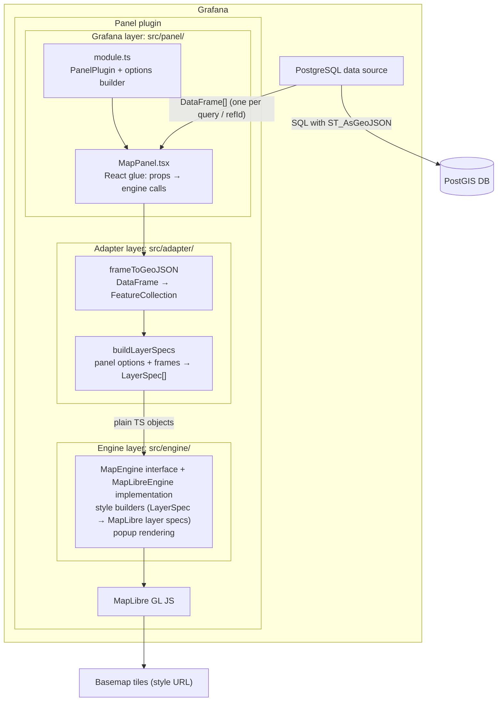

# Target Architecture: GeoFlow, a Grafana PostGIS Map Panel

Status: **Proposal, awaiting approval.** Nothing here is implemented yet.

### Project baseline

| Item | Value |
|---|---|
| Plugin name | GeoFlow |
| Plugin id | `jdejesusio-geoflow-panel` |
| Layer binding | Selectable mode; MVP ships "one layer per data frame" only (§3.4) |
| Target Grafana | 13.2+ (`grafanaDependency: ">=13.2.0"`) |
| Database | PostgreSQL 16+ with PostGIS 3.x |
| Default basemap | OpenStreetMap standard raster tiles |
| License | Apache-2.0; dependency license compatibility check pending (§5.4) |
| Dev environment | Docker Compose; deployment files under `docker/grafana/` and `docker/postgres/` |

This document responds to the five pre-implementation items in [project_overview.md](project_overview.md):

1. Application architecture
2. Major components and responsibilities
3. Data frame → GeoJSON conversion
4. Compatibility and performance risks
5. Development and testing strategy

---

## 1. Architectural overview

The plugin is a **frontend-only Grafana panel plugin**. It has no backend component and opens no database connection of its own. All data reaches it through Grafana's built-in PostgreSQL data source, as `DataFrame`s in `PanelProps.data`.



### Key decisions

| Decision | Rationale |
|---|---|
| Panel plugin only, no backend | Requirement 1 and 2. Grafana's PostgreSQL data source already handles auth, connection pooling, macros, template variables and caching. |
| SQL returns GeoJSON text via `ST_AsGeoJSON(...)` | GeoJSON is what MapLibre consumes natively. Parsing WKB in the browser would add a dependency and CPU cost for no MVP benefit. |
| Three layers: panel / adapter / engine | Requirement 7. The engine can be tested, reused or replaced (for example by OpenLayers or deck.gl) without touching Grafana code. |
| Engine boundary enforced by lint, not convention | An ESLint `no-restricted-imports` rule on `src/engine/**` forbids `@grafana/*`, `react` and `../panel`/`../adapter` imports. |
| Layer binding is a selectable mode, starting with "one layer per data frame" | Per-frame binding maps onto Grafana's existing query editor UX, where users already add queries A, B, C. "Layers by column value" is added in a later phase. Both modes live in the adapter and produce the same `LayerSpec[]`, so the engine never changes (§3.4). |
| Map instance is created once and updated in place | Re-creating a WebGL context on every refresh is slow and leaks contexts. Data updates go through `GeoJSONSource.setData()`. |

---

## 2. Components and responsibilities

### 2.1 Directory layout

Scaffolded with `npx @grafana/create-plugin@latest` (panel type). The repository then follows the standard layout, with three source subfolders and a `docker/` directory holding one independent directory per service:

```
docker-compose.yaml            # root compose file; wires the services below
                               # (kept at root so create-plugin's `npm run server` works)
docker/
  grafana/                     # Grafana deployment files; the image itself is the
                               # scaffold-managed .config/Dockerfile (live reload, CI modes)
    .env.example               # data source connection settings (GEOFLOW_PG_*)
    provisioning/
      datasources/datasources.yml # GeoFlow PostGIS data source → postgres service
      dashboards/              # dashboard provider + one JSON dashboard per feature
  postgres/                    # everything the database container needs
    Dockerfile                 # FROM postgis/postgis:16-3.6
    .env.example               # POSTGRES_USER / PASSWORD / DB, reader password
    verify.sql                 # fixture sanity checks
    init/                      # executed on first start via /docker-entrypoint-initdb.d
      01_extensions.sql        # CREATE EXTENSION postgis
      02_schema.sql
      03_seed_fixtures.sql     # every geometry type, non-4326, invalid/empty rows
      04_seed_large.sql        # generated rows for performance testing
      05_reader_role.sh        # read-only grafana_reader role
src/
  module.ts                    # PanelPlugin registration + options
  plugin.json
  panel/                       # Grafana-aware layer
    MapPanel.tsx
    options.ts                 # PanelOptions types + builder
    editors/LayersEditor.tsx   # custom option editor for the layer list
  adapter/                     # Grafana DataFrame ⇄ neutral model
    frameToGeoJSON.ts
    detectGeometryField.ts
    buildLayerSpecs.ts
    __tests__/
  engine/                      # framework-neutral rendering
    types.ts                   # LayerSpec, LayerStyle, ViewState, MapEngine
    MapLibreEngine.ts
    styleBuilders.ts           # pure: LayerSpec → maplibre LayerSpecification[]
    popup.ts
    __tests__/
  model/                       # shared plain types (GeoJSON helpers, errors)
tests/                         # Playwright e2e (@grafana/plugin-e2e)
LICENSE                        # Apache-2.0
NOTICE                         # third-party attributions (see §5.4)
```

The Grafana and Postgres directories don't depend on each other. Each one can be rebuilt, swapped (for example an external managed Postgres) or reused in another compose file. The only link between them is the data source provisioning file. It reads the host, user and password from environment variables, so nothing is hard-coded.

### 2.2 Panel layer (`src/panel`, Grafana-aware)

- **`module.ts`**: `new PanelPlugin<MapOptions>(MapPanel).setPanelOptions(...)`. It declares basemap, view and layer options. `useFieldConfig()` is enabled so per-field unit and decimals settings work in popups.
- **`MapPanel.tsx`**: A thin React component.
  - On mount: create a `div`, call `engine.mount(div, initialView, basemap)`.
  - On `data` / `options` change: call the adapter to build `LayerSpec[]`, then call `engine.setLayers(specs)`.
  - On `width` / `height` change: call `engine.resize()`.
  - On theme change (`useTheme2()`): call `engine.setBasemap()` if a light/dark style pair is configured.
  - On unmount: call `engine.destroy()`.
  - Shows conversion warnings (for example "12 rows had invalid geometry") through Grafana's panel notice mechanism. Shows "No data" or a configuration hint when no geometry field is found.
- **`LayersEditor.tsx`**: A custom option editor for the ordered list of spatial layers (add, remove, reorder, per-layer settings).

### 2.3 Adapter layer (`src/adapter`)

This is the only place that knows about both `DataFrame` and GeoJSON. Its functions are pure, deterministic and unit-testable.

- `detectGeometryField(frame)`: picks the geometry column (see §3).
- `frameToFeatureCollection(frame, mapping) → { fc, warnings }`.
- `buildLayerSpecs(frames, options, theme) → LayerSpec[]`: joins the layer configuration with frames by `refId` and resolves style defaults from the Grafana theme. Popup display values are pre-formatted with Grafana's field display processor, so the engine never needs Grafana formatting code.

### 2.4 Engine layer (`src/engine`, Grafana-independent)

A neutral contract:

```ts
interface MapEngine {
  mount(container: HTMLElement, view: ViewState, basemap: BasemapSpec): void;
  setBasemap(basemap: BasemapSpec): void;
  setLayers(layers: LayerSpec[]): void;      // diffed: add/update/remove
  fitToData(padding?: number): void;
  setView(view: ViewState): void;
  resize(): void;
  on(event: 'featureClick' | 'viewChange', cb: (...) => void): () => void;
  destroy(): void;
}

interface LayerSpec {
  id: string;                  // stable across refreshes
  name: string;
  visible: boolean;
  data: FeatureCollection;
  style: LayerStyle;           // color, opacity, radius, lineWidth, fillOpacity…
  popup: { enabled: boolean; fields: string[] | 'all' };
}
```

- **`MapLibreEngine`** implements the contract. Each `LayerSpec` maps to one GeoJSON source and up to four MapLibre style layers:
  - `fill` and a `line` outline for Polygon and MultiPolygon
  - `line` for LineString and MultiLineString
  - `circle` for Point and MultiPoint

  Each style layer is filtered by geometry type: `['match', ['geometry-type'], ['Polygon','MultiPolygon'], true, false]`. The list form keeps the filter correct across MapLibre versions, which differ on whether Multi* types are reported separately.
- **`setLayers`** diffs against current state by `id`:
  - Unchanged layer: no-op.
  - Changed data: `setData()`.
  - Changed style: `setPaintProperty()`.
  - Add or remove: add or remove the source and its layers.
  - Re-adds everything after a basemap `setStyle()`, which drops user layers. Alternatively, uses `setStyle(..., { transformStyle })` to carry the layers over.
- **`styleBuilders.ts`** is pure: `LayerSpec → LayerSpecification[]`. Most styling logic can therefore be tested without WebGL.
- **Popups**: on click, query rendered features across this plugin's layers, then show a `maplibregl.Popup` built from the pre-formatted properties. The popup is built as DOM text nodes, never `innerHTML` (attribute values are untrusted data).

---

## 3. Converting Grafana data frames to GeoJSON

### 3.1 Expected query shape

Users write queries in **Table** format, not Time series format, which would pivot the columns:

```sql
SELECT
  id,
  name,
  status,
  ST_AsGeoJSON(ST_Transform(geom, 4326), 6) AS geometry
FROM assets
WHERE $__timeFilter(updated_at)   -- optional; any Grafana macro works
```

- Everything in this section works on PostgreSQL 16+ with PostGIS 3.x. `ST_AsGeoJSON(record)` (Feature output) needs PostGIS 3.0 or later.
- `ST_Transform(..., 4326)` is required unless the data is already in WGS84. GeoJSON (RFC 7946) and MapLibre assume lon/lat.
- The precision argument (`6` ≈ 0.1 m) roughly halves payload size compared with the default of 9 decimals.

Also accepted:

- A column containing a full **GeoJSON Feature**, e.g. `ST_AsGeoJSON(t.*)`. Its `properties` are merged with the other columns.
- A `json` / `jsonb` geometry column. On Grafana 13.2 this arrives as a field of type `other` whose values are already-parsed objects (verified in Phase 0); string values are handled too.

### 3.2 Geometry field resolution

Resolution runs in this order:

1. An explicit field name from the layer config.
2. A field named `geometry`, `geom`, `geojson`, `the_geom` or `wkb_geometry` (case-insensitive).
3. The first string or other field whose first non-null value parses as GeoJSON geometry or Feature.

If nothing matches, the panel shows a hint with an example query instead of failing silently.

### 3.3 Row conversion algorithm

```
for each row i in 0..frame.length:
  raw = geomField.values[i]
  if raw is null/empty            → skip (count as "empty")
  obj = typeof raw === 'string' ? JSON.parse(raw) : raw      (try/catch → "invalid")
  if obj.type === 'Feature'       → geometry = obj.geometry, baseProps = obj.properties
  else                            → geometry = obj, baseProps = {}
  validate geometry.type ∈ {Point, MultiPoint, LineString, MultiLineString,
                            Polygon, MultiPolygon}           (else "unsupported")
  properties = baseProps ∪ { other field name → field.values[i] }
  id = idField ? idField.values[i] : i
  push { type:'Feature', id, geometry, properties }
return { FeatureCollection, warnings: {empty, invalid, unsupported} }
```

Notes:

- The adapter iterates `field.values` arrays directly instead of using `DataFrameView`. This avoids creating a proxy object per row on large frames.
- **Feature ids**: MapLibre's feature-state (hover highlighting) needs numeric ids or `promoteId`. If the `id` column is non-numeric, the adapter assigns the row index as `id` and keeps the original value in `properties`.
- **Nested property values** (objects or arrays) are JSON-stringified, because MapLibre flattens them anyway.
- **Display values** for popups are computed with `field.display(value)` and stored in a separate map per layer keyed by feature id. This keeps feature properties raw for data-driven styling later.
- **Not supported in MVP**:
  - `GeometryCollection`: counted as "unsupported" and reported.
  - Z/M coordinates: passed through; MapLibre ignores them.
  - Raw WKB / EWKB hex: left for a later phase if requested.

### 3.4 Layer binding modes

How data frames become map layers is a panel option, `layerBinding.mode`:

| Mode | Behavior | Delivered in |
|---|---|---|
| `perFrame` (default) | Each data frame (one per query refId) becomes one layer. Layer id = `refId`. Layer config can override the geometry field, id field, style and popup fields. | MVP (Phases 3–6) |
| `byColumn` | The user picks a source frame and a **split column**. Each distinct value of that column becomes its own layer with id `${refId}:${value}`. Layer names come from the values. | Phase 10 |

Design rules that keep later modes cheap to add:

- The option type is a discriminated union from day one:

  ```ts
  type LayerBinding =
    | { mode: 'perFrame' }
    | { mode: 'byColumn'; refId: string; splitField: string; maxLayers: number };
  ```

  Saved MVP dashboards stay valid when `byColumn` ships, because no migration is needed. Until then the editor offers only `perFrame`.
- Binding is resolved in `buildLayerSpecs` (adapter) through a small strategy per mode: `bindPerFrame` and later `bindByColumn`. Each strategy returns the same `LayerSpec[]`. The engine is unaffected, which is the payoff of requirement 7.
- `byColumn` specifics, scoped for Phase 10:
  - **Stable ids across refresh.** Per-layer settings such as visibility and style overrides survive a refresh, and new values get defaults.
  - **Layer cap.** `maxLayers`, default 50, guards against splitting on a high-cardinality column. Values beyond the cap are grouped into an "Other" layer and reported as a panel warning.
  - **Per-value colors.** Values get colors from the Grafana theme's classic palette, overridable through standard Grafana value mappings.
  - **Null or empty split values** go into a "(none)" layer.

---

## 4. Compatibility and performance risks

### 4.1 Compatibility

| Risk | Mitigation |
|---|---|
| **Grafana version range.** Plugin APIs and the data source id changed over time (`postgres` → `grafana-postgresql-datasource`). | Target Grafana 13.2 and later: `grafanaDependency: ">=13.2.0"` in `plugin.json`, with `@grafana/*` packages pinned to 13.2.x. Do not depend on the data source id; read only `DataFrame`s. Run e2e tests against the minimum and latest versions (resolved by CI from `grafanaDependency`). |
| **PostgreSQL / PostGIS versions.** | Support PostgreSQL 16+ with PostGIS 3.x. The dev image is pinned to `postgis/postgis:16-3.6`. An optional CI job runs the fixtures against the newest Postgres major to catch SQL differences in the documented queries. |
| **Content Security Policy.** MapLibre spawns web workers from `blob:` URLs, and Grafana's optional CSP can block them. | Document the required `worker-src blob:` CSP directive. Evaluate `maplibregl.setWorkerUrl()` with a worker file shipped in the plugin bundle as a fallback. |
| **WebGL availability.** MapLibre v5 requires WebGL2. Headless renderers, old GPUs and VDI environments may lack it. | Detect support on mount and show a clear message instead of a blank panel. Document the image renderer limitation. |
| **Basemap tiles and air-gapped installs.** Public tile servers have usage policies and need internet access. | The default is OpenStreetMap's standard raster tiles (`https://tile.openstreetmap.org/{z}/{x}/{y}.png`). They're wrapped in a minimal inline MapLibre style, because OSM serves tiles, not a style JSON. Caveats: OSM's [tile usage policy](https://operations.osmfoundation.org/policies/tiles/) forbids heavy or bulk use and requires the attribution "© OpenStreetMap contributors". The panel always shows that attribution through MapLibre's attribution control. The basemap is configurable (raster tile URL template or a vector style URL) so production users can point at their own tile server. A "no basemap" (blank background) option covers air-gapped installs. |
| **MapLibre CSS.** Without it, controls and popups render broken. | Import `maplibre-gl/dist/maplibre-gl.css` in the panel module, and scope overrides with Emotion (`useStyles2`) to avoid leaking into Grafana. |
| **Panel lifecycle.** Grafana unmounts panels when they scroll out of view, open in panel edit, or appear in repeated rows. Browsers cap WebGL contexts at about 16. | Always call `map.remove()` on unmount. Avoid re-creating the map on option changes. Test dashboards with many map panels. |
| **Theme switching** (light/dark). | OSM raster tiles have no dark variant. In dark theme the engine adjusts `raster-brightness-max` / `raster-saturation` paint properties to dim the basemap, which needs no second tile source. Users can also configure an explicit dark basemap. Default layer colors come from `theme.visualization`. |
| **Coordinate systems.** Data not in EPSG:4326 renders in the wrong place or not at all. | Document `ST_Transform` usage. The adapter warns when coordinates fall outside ±180/±90. |
| **Antimeridian-crossing geometries.** | These are known MapLibre/GeoJSON edge cases. Document the issue rather than solve it in the MVP. |

### 4.2 Performance

| Concern | Approach |
|---|---|
| **Payload size.** GeoJSON text is verbose. | Recommend `ST_AsGeoJSON(geom, 6)`. For detailed polygons, recommend `ST_SimplifyPreserveTopology`. Mention the data source row limit (`row_limit` in Grafana config). |
| **Main-thread parsing.** `JSON.parse` per row plus FeatureCollection construction blocks the UI on large results. | Benchmark at 1k, 10k, 100k features in Phase 8. If 100k blocks too long, move conversion to a web worker. MapLibre's own `geojson-vt` tiling already runs in its worker. |
| **Redundant work on refresh.** | Memoize conversion per frame and skip `setData` when the frame has not changed (same frame reference / structural hash). Keep the viewport across refreshes unless "fit to data on refresh" is on. |
| **Re-renders from React.** | Hold the engine in a `useRef`. Effects depend on narrow inputs (`data.series`, `options.layers`, `width`, `height`), never on the whole props object. |
| **Bundle size.** MapLibre is about 800 KB minified. | This is acceptable for a panel plugin, and Grafana loads plugin bundles lazily. Check the size in CI to catch regressions. |
| **Beyond about 100k features.** | Out of scope for the MVP. The future path is vector tiles from PostGIS (`ST_AsMVT` via Martin or pg_tileserv). This would be a deliberate exception to "Grafana data source only" and needs separate approval. |

---

## 5. Development and testing strategy

### 5.1 Local environment

- Scaffold with `@grafana/create-plugin`. It provides webpack, Jest, Playwright, ESLint, the Docker Compose Grafana dev image and GitHub Actions CI.
- Keep the scaffold-managed Grafana image (`.config/`, Grafana 13.2.x) and put the Grafana deployment files (provisioning, env) in `docker/grafana/`. The built plugin (`dist/`) is mounted as `jdejesusio-geoflow-panel`.
- Add a `postgres` service built from `docker/postgres/` (`postgis/postgis:16-3.6`). Seed it from `docker/postgres/init/` with fixture tables covering every geometry type, a non-4326 table, invalid and empty rows, and a large table for performance tests. Use a named volume for data. `docker compose down -v` resets it to the seed state.
- Provision the PostgreSQL data source and a set of dashboards in `docker/grafana/provisioning/`. Each dashboard exercises one feature: points only, mixed types, multi-layer, refresh. Every dashboard doubles as an e2e fixture.
- The root `docker-compose.yaml` adds a healthcheck on `postgres` (`pg_isready`). Grafana uses `depends_on: condition: service_healthy`, so provisioned dashboards never start against an unready database.

### 5.2 Test pyramid

| Level | Tooling | Covers |
|---|---|---|
| Unit | Jest | Adapter: `frameToFeatureCollection` across all geometry types, Feature input, string vs object values, null/invalid/unsupported rows, id handling, field detection. Engine: `styleBuilders` output and the `setLayers` diff logic with `maplibre-gl` mocked. jsdom has no WebGL, so the real map is not exercised here. |
| Component | Jest + React Testing Library | `MapPanel` calls the engine correctly on mount, data change, resize and unmount. Uses a fake `MapEngine`, which is another payoff of the interface. Covers the "no geometry field" hint. |
| End-to-end | Playwright + `@grafana/plugin-e2e` against the Docker stack | The panel loads in provisioned dashboards. The canvas renders. Clicking a known feature opens a popup with the expected attributes. Option changes take effect. Dashboard refresh updates features. Runs against the minimum supported Grafana (13.2) and the latest release. |
| Manual / perf | Provisioned "large" dashboard + browser profiler | Conversion and render timings at 1k, 10k and 100k features. |

CI runs lint (including the engine import boundary), typecheck, unit tests, build, `@grafana/plugin-validator`, the license check (§5.4) and e2e on every PR.

### 5.3 Incremental delivery plan

Each phase ends with something demonstrable and its own tests. I will stop for review after each phase.

| Phase | Deliverable | Verified by |
|---|---|---|
| 0 | Scaffold, `docker/grafana` + `docker/postgres` stack with seed data, provisioned data source, placeholder panel, Apache-2.0 `LICENSE` | Panel appears in Grafana 13; CI green |
| 1 | Adapter: `frameToFeatureCollection` + field detection (no UI) | Unit tests |
| 2 | Engine skeleton: `MapEngine`, `MapLibreEngine` with basemap only, mount/resize/destroy; panel shows interactive basemap | Component test + e2e "map canvas visible" |
| 3 | Single-layer rendering of all six geometry types with default style | Style-builder unit tests + e2e on mixed-geometry dashboard |
| 4 | Popups with feature attributes (formatted via field config) | e2e click → popup content |
| 5 | Basic styling options (color, opacity, point radius, line width, fill opacity) | Unit tests + e2e option change |
| 6 | Multiple layers in `perFrame` mode: layer list editor, `LayerBinding` option (only `perFrame` exposed), ordering, visibility | Unit tests on `buildLayerSpecs` + e2e multi-layer dashboard |
| 7 | Refresh behavior: in-place `setData`, viewport preservation, fit-to-data option, theme switching | Component tests + e2e refresh |
| 8 | Hardening: warnings/notices, WebGL detection, CSP docs, performance benchmark and any resulting optimization | Perf dashboard results recorded in docs |
| 9 | Dependency license compatibility review (§5.4) | `docs/licenses.md` report; CI license gate passing |

Phases 0–9 make up the **MVP**. Post-MVP phases each add one capability:

| Phase | Deliverable | Verified by |
|---|---|---|
| 10 | `byColumn` layer binding (§3.4): split column picker, layer cap + "Other", per-value colors, stable ids across refresh | Unit tests on `bindByColumn` (cardinality, nulls, id stability) + e2e dashboard split by a category column |

### 5.4 License compliance

The project is licensed under **Apache-2.0**. Every dependency that ends up in the shipped bundle (`dist/`) must have a license compatible with distributing it under Apache-2.0. Dev-only tooling matters less, because it isn't redistributed.

- **Known so far (to be confirmed in the review):**
  - `maplibre-gl` is BSD-3-Clause, which is compatible.
  - `@grafana/*` runtime packages are Apache-2.0. They are provided by Grafana at runtime as externals, not bundled.
  - React is MIT.
- **Basemap data is not code.** OpenStreetMap data is under ODbL, which is not a dependency license. It obliges visible attribution ("© OpenStreetMap contributors"), which the panel always displays. This goes in `NOTICE` and the README.
- **Process:**
  1. From Phase 0, a license scanner (for example `license-checker-rseidelsohn` or `license-report`) runs in CI over production dependencies.
  2. An allow-list (Apache-2.0, MIT, BSD-2/3-Clause, ISC, 0BSD, CC0-1.0) passes automatically.
  3. Anything else, especially GPL/AGPL/LGPL, SSPL or unknown, fails the build until it's reviewed.
  4. The Phase 9 review produces `docs/licenses.md` and a populated `NOTICE` file before the first public release.

---

## 6. Decisions

All open items are resolved.

| Topic | Decision |
|---|---|
| Plugin name | GeoFlow |
| Plugin id | `jdejesusio-geoflow-panel` (org slug `jdejesusio`) |
| Layer binding | Selectable mode: `perFrame` in the MVP, `byColumn` in Phase 10 |
| Grafana version | 13.2+ |
| PostgreSQL version | 16+ (PostGIS 3.x) |
| Default basemap | OpenStreetMap standard raster tiles, with attribution |
| License | Apache-2.0, pending the dependency license review |
| Dev environment | Docker; `docker/grafana/` and `docker/postgres/` kept independent |
