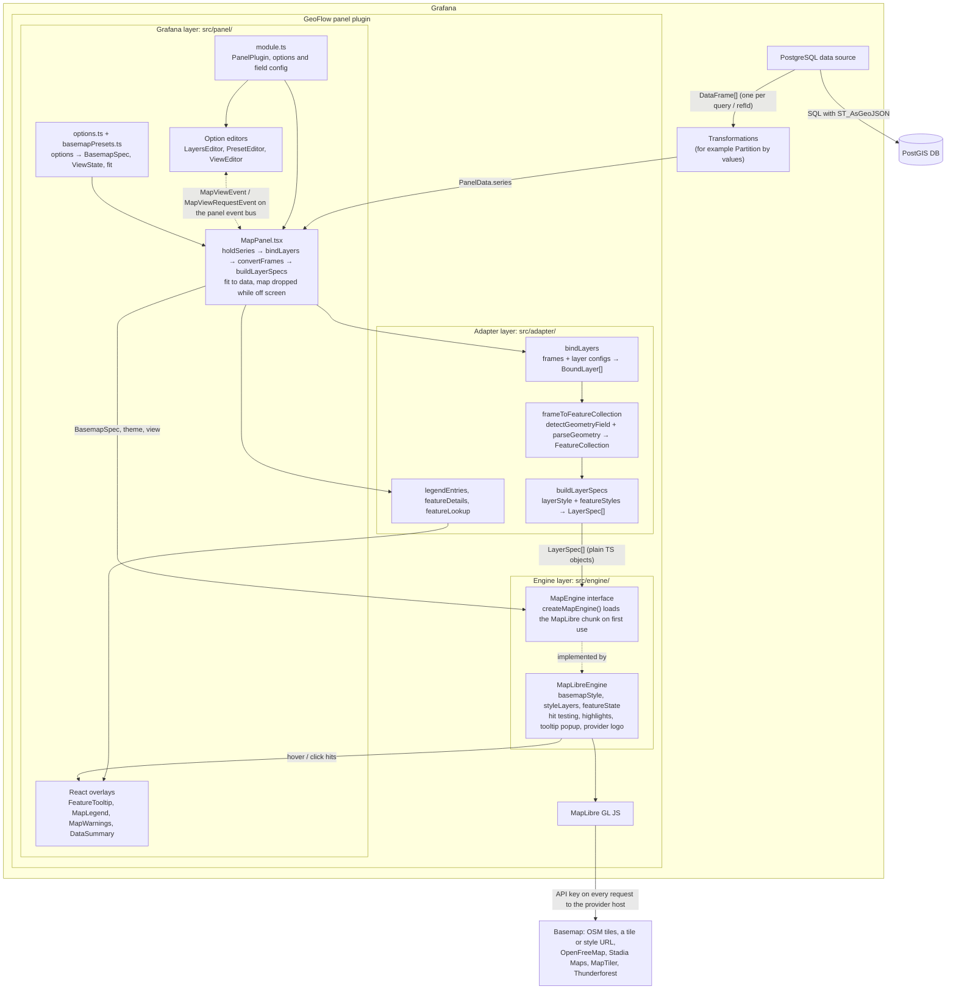

# Architecture: GeoFlow, a Grafana PostGIS Map Panel

Status: **Implemented through Phase 12.** This document began as the proposal that the phases were built from, and now describes the plugin as built. Each phase's design, decisions and outcome are in `docs/phase_N.md`; §5.3 lists the phases, and §7 the features considered for later. Node-edge maps, a network of nodes and the edges between them, have their own design and phases in [node-edge/architecture.md](node-edge/architecture.md); its Phases 1 and 2 (edges drawn, set up in the Layers list) are implemented.

### Project baseline

| Item | Value |
|---|---|
| Plugin name | GeoFlow |
| Plugin id | `jdejesusio-geoflow-panel` |
| Layer binding | Selectable mode; MVP ships "one layer per data frame" only (§3.4) |
| Target Grafana | 13.2+ (`grafanaDependency: ">=13.2.0"`) |
| Database | PostgreSQL 16+ with PostGIS 3.x |
| Default basemap | OpenStreetMap standard raster tiles |
| License | Apache-2.0, confirmed by the Phase 10 review (§5.4, [licenses.md](licenses.md)) |
| Dev environment | Docker Compose; deployment files under `docker/grafana/` and `docker/postgres/` |

This document responds to the five pre-implementation items in [project_overview.md](project_overview.md):

1. Application architecture
2. Major components and responsibilities
3. Data frame → GeoJSON conversion
4. Compatibility and performance risks
5. Development and testing strategy

---

## 1. Architectural overview

The plugin is a **frontend-only Grafana panel plugin**. It has no backend component and opens no database connection of its own. All data reaches it through Grafana's built-in PostgreSQL data source, as `DataFrame`s in `PanelProps.data`.



### Key decisions

| Decision | Rationale |
|---|---|
| Panel plugin only, no backend | Requirement 1 and 2. Grafana's PostgreSQL data source already handles auth, connection pooling, macros, template variables and caching. |
| SQL returns GeoJSON text via `ST_AsGeoJSON(...)` | GeoJSON is what MapLibre consumes natively. Parsing WKB in the browser would add a dependency and CPU cost for no MVP benefit. |
| Three layers: panel / adapter / engine | Requirement 7. The engine can be tested, reused or replaced (for example by OpenLayers or deck.gl) without touching Grafana code. |
| Engine boundary enforced by lint, not convention | An ESLint `no-restricted-imports` rule on `src/engine/**` forbids `@grafana/*`, `react` and `../panel`/`../adapter` imports. |
| Layer binding is a selectable mode, starting with "one layer per data frame" | Per-frame binding maps onto Grafana's existing query editor UX, where users already add queries A, B, C. "Layers by column value" is added in a later phase. Both modes live in the adapter and produce the same `LayerSpec[]`, so the engine never changes (§3.4). |
| Map instance is created once and updated in place | Re-creating a WebGL context on every refresh is slow and leaks contexts. Data updates go through `GeoJSONSource.setData()`. The one exception is scrolling: a panel destroys its map once it is off screen and creates it again when it comes back (§4.1, panel lifecycle). |

---

## 2. Components and responsibilities

### 2.1 Directory layout

Scaffolded with `npx @grafana/create-plugin@latest` (panel type). The repository then follows the standard layout, with the three layers and a shared model as source subfolders, and a `docker/` directory holding one independent directory per service:

```
docker-compose.yaml            # root compose file; wires the services below
                               # (kept at root so create-plugin's `npm run server` works)
docker/
  grafana/                     # Grafana deployment files; the image itself is the
                               # scaffold-managed .config/Dockerfile (live reload, CI modes)
    .env.example               # data source connection settings (GEOFLOW_PG_*)
    provisioning/
      datasources/datasources.yml # GeoFlow PostGIS data source → postgres service
      dashboards/              # dashboard provider + one JSON dashboard per feature
                               # (00-smoke … 14-node-edge)
  postgres/                    # everything the database container needs
    Dockerfile                 # FROM postgis/postgis:16-3.6
    .env.example               # POSTGRES_USER / PASSWORD / DB, reader password
    verify.sql                 # fixture sanity checks
    init/                      # executed on first start via /docker-entrypoint-initdb.d
      01_extensions.sql        # CREATE EXTENSION postgis
      02_schema.sql
      03_seed_fixtures.sql     # every geometry type, non-4326, invalid/empty rows
      04_seed_large.sql        # generated rows for performance testing
      05_reader_role.sh        # read-only grafana_reader role
      06_seed_network.sql      # sites and trunks, for node-edge maps
src/
  module.ts                    # PanelPlugin registration, options and field config
  plugin.json
  img/                         # plugin logo
  panel/                       # Grafana-aware layer; tests sit beside the files
    MapPanel.tsx               # React glue: props → adapter → engine calls
    options.ts                 # GeoFlowOptions, defaults, migration, options → BasemapSpec / ViewState
    basemapPresets.ts          # providers, styles, keys and attribution (Phase 12)
    holdSeries.ts              # keeps a failed query's last good frames (Phase 9)
    convertFrames.ts           # converts frames, reusing unchanged results (Phase 8), and joins networks
    fitData.ts                 # when Fit to data fits, and the bounds it fits to
    panelProblems.ts           # warnings shown on the map (Phase 9)
    conversionSummary.ts       # skipped-row counts and labels
    viewEvents.ts              # map view events on the panel event bus (Phase 8)
    useFeatureTooltip.tsx      # hover and click → tooltip state and engine highlights
    useOnScreen.ts             # drops the map while the panel is off screen
    FeatureTooltip.tsx         # tooltip content, with Grafana's tooltip components
    MapLegend.tsx  MapWarnings.tsx  DataSummary.tsx
    LayersEditor.tsx           # option editor for the layer list (Phase 7)
    ViewEditor.tsx             # Use current view (Phase 8)
    PresetEditor.tsx           # a preset's Style and Dark theme style (Phase 12)
    CheckedTextEditor.tsx      # text option with inline validation
    testHook.ts                # e2e-only inspect event (// Test hook:)
  adapter/                     # Grafana DataFrame ⇄ neutral model
    index.ts                   # the layer's public API
    bindLayers.ts              # frames + Layers settings → BoundLayer[] (§3.4), roles, networkLayers
    detectEdgeFields.ts        # an edge layer's from and to columns (node-edge)
    joinEdges.ts               # edges + node points → one line per pair of nodes (node-edge)
    detectGeometryField.ts
    parseGeometry.ts           # GeoJSON text or object → geometry, with warnings
    frameToFeatureCollection.ts
    buildLayerSpecs.ts         # BoundLayer[] + results → LayerSpec[]
    layerStyle.ts  dashPattern.ts  featureStyles.ts   # field config → styles
    legend.ts  featureDetails.ts  featureLookup.ts    # legend and tooltip content
    __tests__/  __fixtures__/  __bench__/
  engine/                      # framework-neutral rendering; no @grafana/* or React
    index.ts                   # public API + createMapEngine() (lazy MapLibre chunk)
    types.ts                   # MapEngine, LayerSpec, LayerStyle, BasemapSpec, ViewState
    errors.ts                  # WebGLUnavailableError
    layerStyle.ts              # pure: LayerSpec → MapLibre LayerSpecification[]
    featureState.ts            # pure: per-feature style changes as feature-state
    basemapStyle.ts            # pure: BasemapSpec → MapLibre style, request params, logo
    maplibre/
      MapLibreEngine.ts        # the MapEngine implementation
      workerUrl.ts             # MapLibre's worker as a webpack asset
    __tests__/
  model/                       # shared plain types (GeoJSON, bounds)
tests/                         # Playwright e2e (@grafana/plugin-e2e), one spec per dashboard
  fixtures/                    # shared fixtures, including stubbed basemap hosts
scripts/                       # bench-map.mjs, capture-frames.mjs, check-dist.mjs
webpack/                       # third-party notices plugin and license check (§5.4)
webpack.config.ts              # extends .config/webpack
LICENSE                        # Apache-2.0
NOTICE                         # third-party attributions (see §5.4)
```

The Grafana and Postgres directories don't depend on each other. Each one can be rebuilt, swapped (for example an external managed Postgres) or reused in another compose file. The only link between them is the data source provisioning file. It reads the host, user and password from environment variables, so nothing is hard-coded.

### 2.2 Panel layer (`src/panel`, Grafana-aware)

- **`module.ts`**: `new PanelPlugin<MapOptions>(MapPanel).setPanelOptions(...)`. It declares basemap, view, tooltip and layer options. `useFieldConfig()` is enabled so per-field units, decimals, value mappings and data links work in tooltips (Phase 4), and so each query's layer is styled from its geometry field: Grafana's Color scheme and GeoFlow's Map style options (Phase 5).
- **`MapPanel.tsx`**: A thin React component.
  - On mount (and when the panel scrolls back on screen): create the engine with `createMapEngine()` and call `engine.mount(div, { view, fit, basemap, theme, layers })`.
  - On `data` / `options` change: call the adapter to build `LayerSpec[]`, then call `engine.setLayers(specs)`.
  - On `width` / `height` change: call `engine.resize()`.
  - On theme change (`useTheme2()`): call `engine.setTheme()`, and `engine.setBasemap()` when the basemap has a dark theme URL (Phase 8).
  - In Fit to data, on the first data with geometry, a change to the fit settings, or with Fit on refresh, each query response (a new `requestId`): call `engine.fitBounds()` with the drawn layers' bounds (Phase 8).
  - On unmount: call `engine.destroy()`.
  - Shows conversion warnings (for example "12 rows skipped: invalid 10, out of range 2") in a small warning on the map, with the details on hover (Phase 9). Panels can't add to Grafana's header notices. Shows "No data" or a configuration hint when no geometry field is found.
- **`ViewEditor.tsx`**: **Use current view**, which saves the map's current view as the panel's fixed view. It hears the view from the panel through the panel's `eventBus` (Phase 8).
- **`LayersEditor.tsx`**: A custom option editor for the ordered list of spatial layers (reorder, show and hide, per-layer settings). In `perFrame` mode the list follows the queries, so it has no Add button; settings of a query that has gone can be removed (Phase 7). Style isn't among them: it lives in field config (Phase 5).

### 2.3 Adapter layer (`src/adapter`)

This is the only place that knows about both `DataFrame` and GeoJSON. Its functions are pure, deterministic and unit-testable.

- `detectGeometryField(frame)`: picks the geometry column (see §3).
- `frameToFeatureCollection(frame, mapping) → { fc, warnings }`.
- `bindLayers(frames, configs, binding) → BoundLayer[]` (Phase 7): which layers there are, top first, with their ids, names, order, visibility and columns, from the frames and the Layers list's settings (§3.4).
- `buildLayerSpecs(layers, results, frames, theme) → LayerSpec[]`: the engine's layers, bottom first, with style defaults resolved from the Grafana theme. Tooltip values are formatted with Grafana's field display processor when a feature is hovered or clicked (Phase 4), so the engine never needs Grafana formatting code.
- `featureStyles(frame, result, theme)` and `legendEntries(layers, results, frames, theme)` (Phase 6): per-feature colors and sizes from a column's values, and the legend of those colors, both from Grafana's field config. The engine gets plain colors and numbers.

### 2.4 Engine layer (`src/engine`, Grafana-independent)

A neutral contract:

```ts
interface MapEngine {
  readonly stylesheet: string;               // the map's CSS, for the panel to scope
  mount(container: HTMLElement, options: EngineOptions): Promise<void>; // view or fit, basemap, theme, layers
  setBasemap(basemap: BasemapSpec): void;
  setTheme(theme: EngineTheme): void;         // Phase 8
  setView(view: ViewState): void;
  fitBounds(bounds: Bounds, options: FitOptions): void; // bounds from the panel (Phase 8)
  setLayers(layers: LayerSpec[]): void;      // diffed: add/update/remove
  openTooltip(lngLat, content: HTMLElement, options: { interactive: boolean }): void; // Phase 4
  tooltipSpace(lngLat): { width: number; height: number };
  closeTooltip(): void;
  setHovered(feature: FeatureRef | undefined): void;
  setSelected(feature: FeatureRef | undefined): void;
  resize(): void;
  softwareRendering(): boolean;              // Phase 9
  renderedFeatureCounts(): Promise<Record<string, number>>; // test hook (Phase 3)
  on(event: 'viewChange' | 'hover' | 'click' | 'error' | 'contextLost', listener): () => void;
  destroy(): void;
}

interface LayerSpec {
  id: string;                  // stable across refreshes
  name: string;
  visible: boolean;
  data: FeatureCollection;
  style: LayerStyle;           // color, opacity, radius, lineWidth, fillOpacity…
  featureStyles?: FeatureStyles; // per-feature colors and radii, in feature order (Phase 6)
  interactive: boolean;        // hover and click tooltips, per layer from Phase 7; tooltip fields through field overrides (Phase 4)
}
```

- **`MapLibreEngine`** implements the contract. Each `LayerSpec` maps to one GeoJSON source and up to four MapLibre style layers:
  - `fill` and a `line` outline for Polygon and MultiPolygon
  - `line` for LineString and MultiLineString
  - `circle` for Point and MultiPoint

  Each style layer is filtered by geometry type: `['match', ['geometry-type'], ['Polygon','MultiPolygon'], true, false]`. The list form keeps the filter correct across MapLibre versions, which differ on whether Multi* types are reported separately.
- **`BasemapSpec`**: `osm`, `raster` (tiles and attribution), `style` (a URL) or `none`. Phase 12 adds three provider-neutral fields for its presets, which the panel builds (`src/panel/basemapPresets.ts`): `requestParams`, query parameters added through MapLibre's `transformRequest` to every request to one host, so a key reaches tiles, fonts and sprites; a raster `attribution` that's trusted HTML (`attributionHtml`, presets only; a custom attribution stays plain text); and a `logo`, a linked image beside the attribution.
- **`setLayers`** diffs against current state by `id`:
  - Unchanged layer: no-op.
  - Changed data: `setData()`.
  - Changed style: `setPaintProperty()`.
  - Add or remove: add or remove the source and its layers.
  - A basemap `setStyle()` would drop user layers, so a `transformStyle` given at mount appends them to every new style (as built in Phase 3, below).
- **`layerStyle.ts`** is pure: `LayerSpec → LayerSpecification[]`; `featureState.ts` and `basemapStyle.ts` are pure too. Most styling logic can therefore be tested without WebGL.
- **Tooltips** (Phase 4, details below), following Grafana's own pattern: hovering a feature highlights it and shows a compact tooltip, and clicking pins a full one with a pager for overlapping features and the feature's data links.
  - The engine does the hit testing (rendered features of interactive layers, a few pixels around the pointer), emits `hover` and `click` events, sets the highlights with feature-state, and anchors one `maplibregl.Popup`.
  - The panel renders the tooltip's content with React and Grafana's tooltip components into a DOM element it hands to the engine. The engine stays Grafana-free, and React escapes every value, so attribute values never go through `innerHTML` (they're untrusted data).

#### MapLibre packaging (Phase 2)

MapLibre GL JS 6 shapes how the engine is built and shipped:
- **ESM only.** The package has no CommonJS build. Webpack bundles it without extra configuration. Jest can't load it, so unit tests mock `maplibre-gl` as a virtual module.
- **Lazy loading.** `createMapEngine()` loads the engine, MapLibre and its CSS with a dynamic `import()`, so they stay out of the plugin's initial `module.js`.
- **Scoped CSS.** Grafana's plugin validator rejects CSS imports, because they add global styles to the page. MapLibre's stylesheet is imported as text instead (`?raw`, configured in the root `webpack.config.ts`), and the engine hands it over as `MapEngine.stylesheet`. The panel applies it with Emotion, scoped to the panel, before mounting the map and ahead of its own theme overrides, which then win at the same specificity.
- **Worker.** MapLibre's worker is a separate file. MapLibre looks for it relative to its own `import.meta.url`, which webpack rewrites, so that lookup fails inside a plugin bundle. Instead, `src/engine/maplibre/workerUrl.ts` uses `new URL('maplibre-gl/dist/maplibre-gl-worker.mjs', import.meta.url)`: webpack emits the worker as an asset and resolves its served URL, and the engine passes that to `setWorkerUrl()`. The worker is same-origin, so it starts as a module worker without a `blob:` URL.
- **License notices.** The minified build only links to its license. A root `webpack.config.ts` (extending the scaffold config) adds a plugin that writes `THIRD_PARTY_NOTICES.txt` from the modules webpack bundled. MapLibre's dist file inlines its own dependencies, so their dependency trees are added too. Since Phase 10 the same plugin checks each package's license, and the config copies `NOTICE` into the package.

#### Drawing data (Phase 3)

How the engine draws `LayerSpec`s, as built:
- **`LayerSpec` fields so far:** `id`, `data` and `style`. `style` is a `LayerStyle` with `color`, `fillOpacity`, `lineWidth`, `pointRadius` and `outlineColor`, all resolved values; Phase 5 adds `opacity` and `lineStyle`. The adapter fills them from the Grafana theme and `DEFAULT_LAYER_STYLE`, and from field config since Phase 5. `interactive` arrives with Phase 4 (tooltips), and `name` and `visible` with Phase 7 (below).
- **Ids:** sources and style layers are prefixed `geoflow-layer:` (for example `geoflow-layer:A:fill`). The prefix keeps them apart from the basemap and from layers in a user's style URL. Layer ids come from refIds and are never parsed back out of these strings.
- **Geometry filters:** in MapLibre 6, `['geometry-type']` reports Multi* features as their simple type (MultiPolygon as Polygon). The filters list both forms, which is correct in every version.
- **Basemap changes:** `transformStyle`, passed to the `Map` constructor, appends the data sources and layers to every style MapLibre loads afterwards, inline or from a URL. MapLibre fires `style.load` both after a full style load and after a style it applied in place. The engine tracks readiness with `styledataloading` and `style.load`, and applies any `setLayers` call made in between on `style.load`.
- **Errors:** map errors from a data source carry the layer id (`EngineError.layerId`), so the panel shows them under the query rather than as basemap errors.
- **Test hook:** `MapEngine.renderedFeatureCounts()` waits for the map to be idle and counts distinct drawn features per layer. Only e2e tests use it, through a DOM event on the panel's map container. All test-only code in `src/` is marked `// Test hook:`.

#### Tooltips (Phase 4)

How hover and click tooltips work, as built ([phase_4.md](phase_4.md)):
- **Engine contract additions:**
  - `LayerSpec.interactive`: whether the layer's features can be hovered and clicked
  - `hover` and `click` events with a `PointerHit`: the pointer's `lngLat` and the `FeatureRef`s (`{ layerId, featureId }`) under it, topmost first
  - `openTooltip(lngLat, content, { interactive })`, `closeTooltip()`, and `tooltipSpace(lngLat)`: the largest tooltip that fits on the map when anchored there
  - `setHovered(ref)` and `setSelected(ref)`
- **Hit testing:** the rendered features of interactive layers within 4 px of the pointer, de-duplicated (MapLibre returns a feature once per tile and style layer). Hover runs at most once per animation frame. It reports while the pointer is over features, so a tooltip can follow it, and once when it leaves them. Clicks inside a pinned tooltip aren't map clicks.
- **Tooltip:** one MapLibre `Popup` the engine anchors, with content the panel owns. The panel renders `FeatureTooltip`, built from Grafana's `VizTooltip*` components, into that element through a React portal. A hover tooltip lets the pointer through (`pointer-events: none`); passing the same element again only moves the popup.
- **Tooltip size:** MapLibre opens the popup above or below the point, and centered on it or beside it, wherever it fits, 8 px from the map's edges. It doesn't shrink content that fits nowhere, so the panel sizes the tooltip to `tooltipSpace` when it opens: the room on the roomier side of the point, or centered across it. The header and data links keep their height, and the field list between them scrolls. A pinned tooltip keeps its size while the map pans, so panning can carry it past an edge. A hover tooltip can't be scrolled, since the pointer passes through it; pinning it can.
- **Highlights:** MapLibre feature-state (`hovered`, `selected`), read by `case` expressions in the style layers' paint.
- **Panel state:** `useFeatureTooltip` keeps the hover and pinned state. What's shown is derived from the current engine, basemap, data and Tooltip mode, so a basemap change or a recreated map closes the tooltip without effects that reset state.
- **Values:** formatted when a feature is hovered or clicked, from its data frame row, with the field config Grafana applied (`useFieldConfig()` in `module.ts`).

#### Styling (Phase 5)

How layers are styled, as built ([phase_5.md](phase_5.md)):
- **Where styles live:** in field config, as in Grafana's time series panel. Grafana's standard **Color scheme** (palette and single-color modes only) and GeoFlow's **Map style** options: Opacity, Fill opacity, Line width, Line style with a custom Dash pattern, and Point size. Grafana applies defaults and overrides to every field; `layerStyle` (adapter) reads each layer's style from its frame's geometry field. A **Fields returned by query** override styles one layer.
- **Colors:** the classic palette goes by layer position, as in Phase 3. Single color and shades use Grafana's color calculator. By name hashes the layer's name (frame name or refId), because every query's geometry column may share one name.
- **Engine:** `paintFor` adds the layer's opacity to every paint property and the dash array to lines (in line widths: dashed `[3, 3]`, dotted `[0, 2]`, custom patterns converted from pixels). `layoutFor` gives custom patterns flat line ends, so their lengths come out as typed. A style change diffs paint and layout properties, and resets a property the new style no longer sets.
- **No redraw of data:** Grafana applies field config by building new frames around the same `values` arrays, so the conversion cache is keyed on those arrays, not on frames. A style change reuses the FeatureCollection, and the engine only repaints.

#### Data-driven styling (Phase 6)

How features are colored and sized by a column's value, as built ([phase_6.md](phase_6.md)):
- **Options:** **Color by** and **Size by** (field name pickers) and the size range, in Map style on the geometry field, so a **Fields returned by query** override sets them per layer. The driving column's own Thresholds, by-value Color scheme, Min, Max and value mappings set the colors, as in Grafana's other panels.
- **Colors:** `featureStyles` (adapter) gives each feature the color Grafana's display processor would give its value, from the column's own range rather than Grafana's default range across every number column. For speed, number columns without mappings go straight to Grafana's scale calculator, gradients in 1024 steps, and other columns through the display processor once per distinct value: under 75 ms for 100k features. Results are cached on the column's `values` array and the config's content, since Grafana clones every config on each change.
- **Sizes:** point diameter linear between Min and Max point size across the column's range, clamped; features without a number keep the layer's size.
- **Engine:** `LayerSpec.featureStyles` holds colors and radii in feature order. The engine sets them as feature-state (`color`, `radius`), and the paint of a layer that has them reads `['coalesce', ['feature-state', …], layerValue]`; layers without them keep plain values. A change calls MapLibre only for features whose values changed (`featureStateChanges`), matching features by id when the data changed. States are set again when a style loaded from scratch brings new sources. On 100k points with the GPU, a threshold change that recolors 80% of them causes no task over 130 ms.
- **Legend:** `legendEntries` (adapter) lists each colored layer's value mappings and threshold steps, or its gradient; `MapLegend` (panel) renders them with Grafana's `VizLegend`, bottom left.

#### Multiple layers (Phase 7)

How queries become named, ordered layers, as built ([phase_7.md](phase_7.md)):
- **Options:** `layers`, a list of `LayerConfig`s (`id`, `name`, `visible`, `tooltips`, `geometryField`, `idField`), top layer first, keyed by layer id, holding only what differs from the defaults. `layerBinding` is saved as `{ mode: 'perFrame' }` and not shown. Dashboards saved before Phase 7 have neither, and draw as before.
- **Binding:** `bindLayers` (adapter) switches on the mode; `bindPerFrame` makes one layer per frame (§3.4). It runs before the conversion, which needs each layer's columns and id: `convertFrames` passes them to `frameToFeatureCollection`, and its cache also compares them, so a name, order or visibility change converts nothing. `ConversionResult.layerId` is the layer's id, beside the query's `refId`.
- **Editor:** `LayersEditor` (panel) builds its rows with the same `bindLayers`, from the editor context's frames, and saves every layer in its current order on any change. The list follows the data: rows appear once queries have run.
- **Order and colors:** layers draw in list order through the Phase 3 restacking. Classic palette colors go by frame position, not drawing order or visibility, so moving or hiding a layer recolors nothing. By name hashes a typed name, else what Phase 5 hashed.
- **Engine:** `LayerSpec.name` travels with the spec for the panel; `visible: false` sets `visibility: none` on the layer's style layers, keeping its source and feature-state, and leaves it out of hit testing. On 100k points with the GPU, hiding causes no main-thread task over 50 ms and showing none over 140 ms.
- **Tooltips:** `LayerSpec.interactive` combines the panel's Tooltip option and the layer's Tooltips switch. Tooltips on a layer that's hidden or loses its tooltips close, and a closed pinned tooltip stays closed.

#### Refresh, view and theme (Phase 8)

How refreshes, the view and the theme are handled, as built ([phase_8.md](phase_8.md)):
- **Unchanged refreshes:** a refresh brings new `values` arrays even when nothing changed, and Grafana empties the previous ones once the new data arrives. Each panel keeps a `ConversionHistory`: per layer id, its last conversion and a shallow copy of the data it came from. `convertFrames` compares a frame whose arrays it hasn't seen with that copy, value by value (`===`, so parsed JSON objects always count as changed), and reuses the conversion when they match. The FeatureCollection is then the same object, so the engine skips `setData`. Per-feature colors and sizes are cached by conversion and column, so they're reused too, and the hover tooltip stays open, since `results` is compared by element. On 100k rows, the comparison takes a few milliseconds, and an unchanged refresh causes no main-thread task over 50 ms. Rows must come back in the same order, so queries need `ORDER BY`.
- **Bounds:** `parseGeometry` grows each geometry's box while it checks the coordinates, and `ConversionResult.bounds` is their union, so bounds cost no extra pass.
- **View options:** `view.mode` is `fixed` or `fit`, with `fitOnRefresh`, `padding` and `maxZoom` for fit. New panels default to `fit`. A migration handler (`migrateOptions`) sets `fixed` on panels saved without a mode; Grafana runs it on panels saved with another plugin version or none, before it applies the defaults, which is why the plugin version went to 0.2.0.
- **Fitting:** the panel fits the visible layers' bounds on the first data with geometry, when a fit setting changes, and with Fit on refresh, on each new `requestId` once the query has stopped loading. The first fit is passed to `mount` as `EngineOptions.fit`, so the map never draws the fallback view first. `fitBounds` reduces the padding for maps too small for it, which MapLibre would otherwise refuse with a warning. A recreated map keeps the user's view without fitting.
- **Use current view:** the panel publishes `MapViewEvent`s on its `eventBus` as the map moves, and answers a `MapViewRequestEvent`. Grafana gives option editors the same `eventBus`, so `ViewEditor` hears the view without Grafana's internal instance state.
- **Dark basemap:** `basemapFromOptions(basemap, dark)` swaps in a dark theme tile or style URL while the theme is dark; dark tiles carry `dimInDark: false`. The panel keeps the basemap object while its content is unchanged, so a theme switch without a dark URL doesn't close a pinned tooltip.

---

## 3. Converting Grafana data frames to GeoJSON

### 3.1 Expected query shape

Users write queries in **Table** format, not Time series format, which would pivot the columns:

```sql
SELECT
  id,
  name,
  status,
  ST_AsGeoJSON(ST_Transform(geom, 4326), 6) AS geometry
FROM assets
WHERE $__timeFilter(updated_at)   -- optional; any Grafana macro works
```

- Everything in this section works on PostgreSQL 16+ with PostGIS 3.x. `ST_AsGeoJSON(record)` (Feature output) needs PostGIS 3.0 or later.
- `ST_Transform(..., 4326)` is required unless the data is already in WGS84. GeoJSON (RFC 7946) and MapLibre assume lon/lat.
- The precision argument (`6` ≈ 0.1 m) roughly halves payload size compared with the default of 9 decimals.

Also accepted:

- A column containing a full **GeoJSON Feature**, e.g. `ST_AsGeoJSON(t.*)`. Its `properties` are kept, and shown in tooltips unless a column has the same name.
- A `json` / `jsonb` geometry column. On Grafana 13.2 this arrives as a field of type `other` whose values are already-parsed objects (verified in Phase 0); string values are handled too.

### 3.2 Geometry field resolution

Resolution runs in this order:

1. An explicit field name from the layer config. If no column has that name, this is reported rather than silently falling back to detection.
2. A field named `geometry`, `geom`, `geojson`, `the_geom`, `wkb_geometry` or `shape` (case-insensitive), of type string or other, whose content looks like GeoJSON.
3. The first string or other field whose content parses as GeoJSON geometry or Feature.

"Content" means the first ten non-null values: one malformed leading row doesn't hide a geometry column.

If nothing matches, the panel shows a hint instead of failing silently. When a column holds hex WKB/EWKB (a raw `geom` column), the hint says to wrap it in `ST_AsGeoJSON(...)`.

### 3.3 Row conversion algorithm

```
for each row i in 0..frame.length:
  raw = geomField.values[i]
  if raw is null/empty            → skip (count as "empty")
  obj = typeof raw === 'string' ? JSON.parse(raw) : raw      (try/catch → "invalid")
  if obj.type === 'Feature'       → geometry = obj.geometry, baseProps = obj.properties
  else                            → geometry = obj, baseProps = {}
  validate geometry.type ∈ {Point, MultiPoint, LineString, MultiLineString,
                            Polygon, MultiPolygon}           (GeometryCollection → "unsupported")
  crs member other than EPSG:4326 / CRS84                    → skip ("projected", names the CRS)
  empty coordinates (PostGIS POINT EMPTY → [])               → skip ("empty")
  coordinates nested wrongly or not finite numbers           → skip ("invalid")
  any position outside lon ±180 / lat ±90                    → skip ("outOfRange")
  properties = baseProps                 (columns stay in the frame, where tooltips read them; Phase 9)
  id = ids from the id column if all are unique finite numbers, else i
  push { type:'Feature', id, geometry, properties }
return { FeatureCollection, warnings: counts per kind + first five samples }
```

Notes:

- The adapter iterates `field.values` arrays directly instead of using `DataFrameView`. This avoids creating a proxy object per row on large frames.
- **Feature ids and keys** (Phase 4): two separate identities.
  - **MapLibre's feature id** is used for hit testing and feature-state highlights. MapLibre keeps ids only as non-negative whole numbers: it reads a negative id back as an unsigned 64-bit number and cuts decimals, so 7.2 and 7.7 collide (checked in Phase 4, step 4.1). The `id` column's values are used only when every one is a unique whole number from 0 to `Number.MAX_SAFE_INTEGER`. Otherwise every feature gets its row index, so a fallback id can never collide with a real one.
  - **The feature key** follows a feature through a refresh. It's the `id` column's value, a number or a string, when every feature has one and they're all unique; otherwise there are no keys.
  - Each conversion also records every feature's row (`featureRows`), and `featureRow`, `featureKey` and `featureByKey` look features up with cached maps.
- **Nested property values** (objects or arrays) are JSON-stringified, because MapLibre flattens them anyway.
- **Display values** for tooltips are computed with `field.display(value)` and never stored on features. Phase 4 formats them when a feature is hovered or clicked, rather than up front for every row ([phase_4.md](phase_4.md)).
- **Not supported in MVP**:
  - `GeometryCollection`: counted as "unsupported" and reported.
  - Z/M coordinates: passed through; MapLibre ignores them.
  - Raw WKB / EWKB hex: left for a later phase if requested.

### 3.4 Layer binding modes

How data frames become map layers is a panel option, `layerBinding.mode`:

| Mode | Behavior | Delivered in |
|---|---|---|
| `perFrame` (default) | Each data frame becomes one layer. Layer id = `refId`, or `${refId}:${frame name}` for each frame when a query returns several (Phase 7). Layer config, keyed by layer id, can override the geometry field and id field; tooltip fields come from field overrides. Style comes from field config, per query through overrides (Phase 5, decision 1). | MVP (Phases 3–7) |

Splitting one query into a layer per value is left to Grafana's **Partition by values** transformation (below), with Phase 11's warning and README walk-through filling its gaps. A `byColumn` mode that splits in the adapter is a feature for later (§7). The design rules below keep that, or any other mode, cheap to add:

- The option type is a discriminated union from day one:

  ```ts
  type LayerBinding =
    | { mode: 'perFrame' }
    | { mode: 'byColumn'; refId: string; splitField: string; maxLayers: number };
  ```

  Saved dashboards would stay valid if `byColumn` shipped, because no migration is needed. Until then the editor offers only `perFrame`.
- Binding is resolved in `bindLayers` (adapter) through a small strategy per mode: `bindPerFrame`, and `bindByColumn` if it ships. Each strategy returns the same `BoundLayer[]`, which `buildLayerSpecs` turns into `LayerSpec`s. The engine is unaffected, which is the payoff of requirement 7.
- **`perFrame` layer ids** (Phase 7): the refId when a query returns one frame. When it returns several, each frame's id is `${refId}:${key}`: the frame's name, else its fields' labels (`placement=aerial`), else `#n` by position. Layer settings are keyed by layer id, so a later `byColumn`'s `${refId}:${value}` layers could use the same settings.
- **Partition by values** (checked in Phase 7, step 7.1), Grafana's transformation that splits a query into a frame per value, already gives `perFrame` one layer per value. Each split frame gets the refId `${refId}-${frame name}`. With its **As frame name** naming, frames are named by value, so a **Fields returned by query** override on `A-aerial` styles that value alone, line style included. With the default **As label**, frames keep the query's (often empty) name and share one refId, so GeoFlow tells them apart by their labels.
- **Why the transformation rather than `byColumn`** (weighed after Phase 9). It already gives what `byColumn` was scoped for:
  - **Stable ids across refresh.** Ids come from the values, not row positions, so layer settings such as visibility stay with a value.
  - **Per-value colors.** The classic palette colors each layer by position. **Classic palette (by series name)** hashes the layer name, so a value keeps its color when other values come and go.
  - **Per-value color and line style.** A **Fields returned by query** override on a value's frame, with **As frame name** naming, so no value-to-line-style mapping is needed (Phase 6, decision 5).
- **What Phase 11 added** for the gaps the transformation leaves:
  - **Many layers.** Splitting on a column with many values (an id, say) makes a layer per value, each a MapLibre source with four style layers. Over 50 layers drawn from data, hidden ones included, the panel warns (Phase 9's warning), whatever produced the frames. Everything is still drawn: 1,000 layers take about 5 s to draw, with pauses of about half a second while panning or hovering, and nothing stalls (§4.2).
  - **Null and empty split values** need no handling in the adapter. Each gets a frame of its own. With **As label** they're `placement=null` and `placement=`. With **As frame name**, Grafana 13.2 names both `''`, so they share the refId `A-` and get position ids (`A-:#1`). A text value `null` can't be told from a null with **As label**. The README shows naming them in SQL (`COALESCE(NULLIF(placement, ''), 'unknown')`).
  - **Frame order** is the order in which values first appear in the rows, so a refresh can recolor (palette by position) and restack layers without saved settings. The README recommends `ORDER BY` on the split column and **Classic palette (by series name)**.
  - **Setting it up:** the README's "Splitting a query by value" walks through it, and the 12 Partition dashboard covers it in e2e tests.

---

## 4. Compatibility and performance risks

### 4.1 Compatibility

| Risk | Mitigation |
|---|---|
| **Grafana version range.** Plugin APIs and the data source id changed over time (`postgres` → `grafana-postgresql-datasource`). | Target Grafana 13.2 and later: `grafanaDependency: ">=13.2.0"` in `plugin.json`, with `@grafana/*` packages pinned to 13.2.x. Do not depend on the data source id; read only `DataFrame`s. Run e2e tests against the minimum and latest versions (resolved by CI from `grafanaDependency`). |
| **PostgreSQL / PostGIS versions.** | Support PostgreSQL 16+ with PostGIS 3.x. The dev image is pinned to `postgis/postgis:16-3.6`. An optional CI job runs the fixtures against the newest Postgres major to catch SQL differences in the documented queries. |
| **Content Security Policy.** Grafana's optional CSP limits `connect-src` to `'self' grafana.com *.cartocdn.com`, and MapLibre fetches raster tiles with `fetch()`. | Checked in Phase 2 with Grafana's default template. The worker, chunks and CSS load without changes, because the worker is a same-origin file set with `setWorkerUrl()` (no `blob:`). Tile servers are blocked until they're added to `connect-src`. The README documents the directive. |
| **WebGL availability.** MapLibre 6 requires WebGL2. Headless renderers, old GPUs and VDI environments may lack it. | Detect support on mount and show a clear message instead of a blank panel. Document the image renderer limitation. |
| **Basemap tiles and air-gapped installs.** Public tile servers have usage policies and need internet access. | The default is OpenStreetMap's standard raster tiles (`https://tile.openstreetmap.org/{z}/{x}/{y}.png`). They're wrapped in a minimal inline MapLibre style, because OSM serves tiles, not a style JSON. Caveats: OSM's [tile usage policy](https://operations.osmfoundation.org/policies/tiles/) forbids heavy or bulk use and requires the attribution "© OpenStreetMap contributors". The panel always shows that attribution through MapLibre's attribution control. The basemap is configurable (raster tile URL template or a vector style URL) so production users can point at their own tile server. A "no basemap" (blank background) option covers air-gapped installs. Phase 12 adds presets: OpenFreeMap, Stadia Maps, MapTiler and Thunderforest, each from one host, with the user's own key where needed (§5.3). |
| **MapLibre CSS.** Without it, controls and tooltips render broken. | The lazily loaded engine module imports `maplibre-gl/dist/maplibre-gl.css`. It is injected after the panel's Emotion styles and wins ties: `.maplibregl-map { position: relative }` collapsed an absolutely positioned map container to zero height, so the container is sized with `width`/`height: 100%`. Overrides that match controls to the Grafana theme are scoped under the panel's class. |
| **Panel lifecycle.** Grafana mounts panels lazily as they scroll into view but doesn't unmount them when they scroll away. Chromium allows 16 live WebGL contexts per page and drops the oldest beyond that. | Found in Phase 2 with a 20-panel dashboard. A panel creates its map only while it is on screen or within 200 px of it (`IntersectionObserver`), and destroys it straight away when it leaves. `map.remove()` releases the context, and a recreated map resumes the user's last view. If a context is still lost, the panel shows "Map paused" with a Reload button. Option changes never recreate the map. The `03-many-panels` e2e test covers this. |
| **Theme switching** (light/dark). | OSM raster tiles have no dark variant. In dark theme the engine adjusts `raster-brightness-max` / `raster-saturation` paint properties to dim the basemap, which needs no second tile source. Users can also configure a dark theme tile or style URL, used undimmed (Phase 8). Default layer colors come from `theme.visualization`. |
| **Coordinate systems.** Data not in EPSG:4326 renders in the wrong place or not at all. | Document `ST_Transform` usage. The adapter warns when coordinates fall outside ±180/±90. |
| **Antimeridian-crossing geometries.** | These are known MapLibre/GeoJSON edge cases. Document the issue rather than solve it in the MVP. |

### 4.2 Performance

| Concern | Approach |
|---|---|
| **Payload size.** GeoJSON text is verbose. | Recommend `ST_AsGeoJSON(geom, 6)`. For detailed polygons, recommend `ST_SimplifyPreserveTopology`. Mention the data source row limit (`row_limit` in Grafana config). |
| **Main-thread parsing.** `JSON.parse` per row plus FeatureCollection construction blocks the UI on large results. | Measured by `npm run bench:map` at 1k, 10k and 100k features (Phase 9), against budgets at 100k points: 200 ms for interactions and unchanged refreshes, 500 ms for new data. All are met on the main thread: 215 ms to load 100k points and 334 ms for a refresh with new data, with 100k points drawn in about 2.2 s. So conversion stays there; a web worker would add copying for no budget it's needed to meet. Features carry no column values, which took 90 ms off new data. 100k simple polygons take one task of about 590 ms, nearly all of it MapLibre serializing the GeoJSON for its worker. |
| **Hover on large data.** Hit testing runs on every pointer move, and a highlight changes feature-state on a large source. | Measured on 100k points in Phase 4 with the machine's GPU: hover is as fast as plain panning, with no main-thread task over 50 ms. Headless Chromium's default software rendering (SwiftShader) is far slower for anything that redraws a large layer, including panning, so performance has to be judged with the GPU (`--enable-gpu --ignore-gpu-blocklist --use-angle=gl`), not in the default e2e browser. |
| **Redundant work on refresh.** | Conversion is cached per frame data (Phase 3, keyed on the frames' `values` arrays since Phase 5), so a frame whose data Grafana didn't replace keeps its FeatureCollection and the engine skips `setData`. That includes every style change. Since Phase 8, a refresh with unchanged data is compared value by value with a copy of the layer's previous data, and reuses its conversion: no main-thread task over 50 ms on 100k rows, when the query has an `ORDER BY`. The viewport is kept across refreshes unless **Fit on refresh** is on. |
| **Re-renders from React.** | Hold the engine in a `useRef`. Effects depend on narrow inputs (`data.series`, `options.layers`, `width`, `height`), never on the whole props object. |
| **Bundle size.** MapLibre 6 is about 1.1 MiB minified, plus a 0.5 MiB worker. | The engine loads MapLibre lazily, so the plugin's initial `module.js` is about 21 KiB gzipped. The Bundle Stats workflow reports size changes on every PR. |
| **Many layers.** Each layer is a GeoJSON source with four style layers, so cost grows with the number of layers as well as features. Partition by values on a column with many values makes a layer per value. | Measured by `npm run bench:map -- --kinds layers` in Phase 11, one point per layer, with the GPU: 50 layers draw in 0.4 s with no task over about 50 ms; 200 in 0.8 s with tasks up to about 110 ms; 1,000 in 4.6 s, with tasks of 400 to 500 ms while panning, hovering, hiding a layer or changing the basemap. The panel warns over 50 layers and still draws them all. |
| **Beyond about 100k features.** | Out of scope for the MVP. The panel warns above 100k features and still draws them (Phase 9). The future path is vector tiles from PostGIS (`ST_AsMVT` via Martin or pg_tileserv). This would be a deliberate exception to "Grafana data source only" and needs separate approval. |

---

## 5. Development and testing strategy

### 5.1 Local environment

- Scaffold with `@grafana/create-plugin`. It provides webpack, Jest, Playwright, ESLint, the Docker Compose Grafana dev image and GitHub Actions CI.
- Keep the scaffold-managed Grafana image (`.config/`, Grafana 13.2.x) and put the Grafana deployment files (provisioning, env) in `docker/grafana/`. The built plugin (`dist/`) is mounted as `jdejesusio-geoflow-panel`.
- Add a `postgres` service built from `docker/postgres/` (`postgis/postgis:16-3.6`). Seed it from `docker/postgres/init/` with fixture tables covering every geometry type, a non-4326 table, invalid and empty rows, and a large table for performance tests. Use a named volume for data. `docker compose down -v` resets it to the seed state.
- Provision the PostgreSQL data source and a set of dashboards in `docker/grafana/provisioning/`. Each dashboard exercises one feature: points only, mixed types, multi-layer, refresh. Every dashboard doubles as an e2e fixture.
- The root `docker-compose.yaml` adds a healthcheck on `postgres` (`pg_isready`). Grafana uses `depends_on: condition: service_healthy`, so provisioned dashboards never start against an unready database.

### 5.2 Test pyramid

| Level | Tooling | Covers |
|---|---|---|
| Unit | Jest | Adapter: `frameToFeatureCollection` across all geometry types, Feature input, string vs object values, null/invalid/unsupported rows, id handling, field detection. Engine: the style builders' output (`layerStyle`, `basemapStyle`) and the `setLayers` diff logic with `maplibre-gl` mocked. jsdom has no WebGL, so the real map is not exercised here. |
| Component | Jest + React Testing Library | `MapPanel` calls the engine correctly on mount, data change, resize and unmount. Uses a fake `MapEngine`, which is another payoff of the interface. Covers the "no geometry field" hint. |
| End-to-end | Playwright + `@grafana/plugin-e2e` against the Docker stack | The panel loads in provisioned dashboards. The canvas renders. Hovering and clicking known features shows tooltips with the expected attributes and data links. Option changes take effect. Dashboard refresh updates features. Runs against the minimum supported Grafana (13.2) and the latest release. |
| Manual / perf | Provisioned "large" dashboard + browser profiler | Conversion and render timings at 1k, 10k and 100k features. |

CI runs lint (including the engine import boundary), typecheck, unit tests, build (which includes the license check, §5.4), `@grafana/plugin-validator` and e2e on every PR.

### 5.3 Incremental delivery plan

Each phase ends with something demonstrable and its own tests. I will stop for review after each phase.

| Phase | Deliverable | Verified by |
|---|---|---|
| 0 | Scaffold, `docker/grafana` + `docker/postgres` stack with seed data, provisioned data source, placeholder panel, Apache-2.0 `LICENSE` | Panel appears in Grafana 13; CI green |
| 1 | Adapter: `frameToFeatureCollection` + field detection (no UI) | Unit tests |
| 2 | Engine skeleton: `MapEngine`, `MapLibreEngine` with basemap only, mount/resize/destroy; panel shows interactive basemap | Component test + e2e "map canvas visible" |
| 3 | Single-layer rendering of all six geometry types with default style | Style-builder unit tests + e2e on mixed-geometry dashboard |
| 4 | Tooltips: hover highlight and tooltip, click to pin, feature attributes formatted via field config, data links | e2e hover and click → tooltip content and links |
| 5 | Basic styling options (color, opacity, point size, line width, line style, fill opacity) in field config, per query through overrides | Unit tests + e2e option change |
| 6 | Data-driven styling: feature color and point size from a column's value, with Grafana's color schemes (thresholds, gradients, value mappings), and a legend | Unit tests on per-feature styles + e2e dashboard styled by value |
| 7 | Multiple layers in `perFrame` mode: a layer list that follows the queries (names, geometry and id columns, tooltips per layer; style stays in field config), ordering, visibility, a layer per frame when a query returns several, settings keyed by layer id, `LayerBinding` option (saved as `perFrame`, not shown yet) | Unit tests on `buildLayerSpecs` + e2e multi-layer dashboard |
| 8 | Refresh, view and theme: unchanged refreshes skip conversion and `setData`, Fit to data view mode (on load or on every refresh; new panels fit, saved panels keep their view), **Use current view**, a dark theme basemap URL | Unit and component tests + e2e refresh dashboard |
| 9 | Hardening: warnings on the map, failed queries and WebGL proven in a real browser, software rendering and row order hints, CSP checked for vector styles, a repeatable benchmark with budgets and any resulting optimization, sizing guidance | Unit and component tests + e2e hardening dashboard; benchmark results recorded in docs |
| 10 | Dependency license compatibility review (§5.4) | `docs/licenses.md` report; CI license gate passing |

Phase 6 comes straight after Phase 5 because it extends Phase 5's field config styling, needs no layer editor, and should be in place before the refresh (Phase 8) and performance (Phase 9) work, which have to account for per-feature styles.

Phases 0–10 make up the **MVP**. Post-MVP phases each add one capability:

| Phase | Deliverable | Verified by |
|---|---|---|
| 11 | Splitting by value with Partition by values (§3.4): a panel warning over 50 layers, null and empty split values checked (no handling needed, named in SQL), the cost of many layers measured, a README walk-through | Unit tests on the layer count warning + e2e dashboard split with Partition by values: a per-value override, null and empty values in both namings, 60 layers |
| 12 | Basemap presets: OpenFreeMap vector styles (Liberty, Bright, Positron; Dark and Fiord) picked by name, a dark style that follows Grafana's theme (building on Phase 8's theme switching), keyed providers (Stadia Maps, MapTiler, Thunderforest) with the user's own API key on every request to the provider, each preset's required attribution and MapTiler's logo, and the CSP (Phase 9) and `NOTICE` (Phase 10) updates for the new hosts. Esri moved to §7 | Unit tests on presets, keys and attribution + e2e dashboard with every provider stubbed, so CI needs no keys |

Phase 12 is post-MVP because the MVP's basemap options can already use any of these services: a vector style URL (for example `https://tiles.openfreemap.org/styles/liberty`) or a raster tile URL with an attribution. The phase makes them a pick from a list, with the attribution filled in. The default stays OpenStreetMap raster, so saved dashboards don't change.

The presets only include services whose terms allow use from any Grafana install without an agreement with the provider:
- **OpenFreeMap:** no key, no view limits, commercial use allowed, funded by donations with no SLA.
- **Keyed providers:** usable on each provider's free tier, under an account the user creates. Stadia Maps' and MapTiler's free tiers are for non-commercial use (checked 2026-11-08), which the README says; the plan is between the user and the provider.

API keys are saved in the panel options, not `secureJsonData`: a tile key reaches every viewer's browser anyway, so providers protect it by restricting the domains it works from. The docs must say so.

Left out:
- **CARTO:** its hosted basemaps need an enterprise agreement or a non-profit grant, and aren't for free public use. Its styles are open (BSD-3, CC-BY 4.0) and work with self-hosted tiles.
- **Google:** the Map Tiles API needs a billing account and session tokens, and Google's terms restrict how its tiles are shown and cached.
- **Esri** (moved to §7 by Phase 12): "Powered by Esri" attribution, its own MapLibre plugin, and session tokens.

Check each service's terms again when the phase is planned.

### 5.4 License compliance

The project is licensed under **Apache-2.0**. Every dependency that ends up in the shipped bundle (`dist/`) must have a license compatible with distributing it under Apache-2.0. Dev-only tooling matters less, because it isn't redistributed.

- **The review** (Phase 10, [licenses.md](licenses.md)) confirmed Apache-2.0. The plugin ships MapLibre (BSD-3-Clause) and its dependencies (MIT, ISC, BSD-2-Clause, BSD-3-Clause), plus two webpack runtime helpers (MIT). `@grafana/*` (Apache-2.0), React and Emotion (MIT) are provided by Grafana at runtime as externals, not bundled.
- **Basemap data is not code.** OpenStreetMap data is under ODbL, which is not a dependency license. It obliges visible attribution ("© OpenStreetMap contributors"), which the panel always displays. This goes in `NOTICE` and the README.
- **Process:**
  1. The production build checks every package it bundles, as it writes `THIRD_PARTY_NOTICES.txt` (since Phase 10; Phases 0–9 scanned all production dependencies, most of them Grafana's, which don't ship).
  2. An allow-list (Apache-2.0, MIT, BSD-2/3-Clause, ISC, 0BSD, CC0-1.0, in `webpack/licenses.ts`) passes automatically. SPDX expressions are read properly: `OR` needs one allowed side, `AND` both.
  3. Anything else, especially GPL/AGPL/LGPL, SSPL or unknown, and a package without license text, fails the build until it's reviewed. An accepted package goes in the exceptions list by name and exact version, with a row in `docs/licenses.md`.
  4. `NOTICE`, `LICENSE` and `THIRD_PARTY_NOTICES.txt` ship in the package; `npm run check:dist` requires them.

---

## 6. Decisions

All open items are resolved.

| Topic | Decision |
|---|---|
| Plugin name | GeoFlow |
| Plugin id | `jdejesusio-geoflow-panel` (org slug `jdejesusio`) |
| Layer binding | `perFrame`; splitting by value through Grafana's Partition by values (Phase 11). `byColumn` is a feature for later (§7). |
| Grafana version | 13.2+ |
| PostgreSQL version | 16+ (PostGIS 3.x) |
| Default basemap | OpenStreetMap standard raster tiles, with attribution |
| License | Apache-2.0, confirmed by the dependency license review (Phase 10) |
| Dev environment | Docker; `docker/grafana/` and `docker/postgres/` kept independent |

---

## 7. Features considered for later

Features that have come up but aren't in a phase yet. Each one would get its own plan and approval before any work starts. The context records why it was left out and what it would take, so the reasoning isn't lost.

| Feature | Context | What it would take |
|---|---|---|
| **Actions in tooltips** | Grafana's actions are buttons, configured per field like data links, that send an HTTP request (for example to acknowledge an alarm or open a ticket). Requested alongside data links, which Phase 4 delivers. Grafana 13's `VizTooltipFooter` accepts ready-made actions, but the code that builds them from a field's action settings, with variable interpolation, confirmation and permission checks, is internal to Grafana and not exported to plugins. Fields carry only the raw `config.actions` settings. | First, check whether the Grafana version of the day exports a way to build actions for plugins. If it does, it's a small addition to the pinned tooltip's footer. If not, the plugin would have to rebuild Grafana's request handling, variable interpolation and confirmation itself, and keep it in step with Grafana. That needs a separate decision. |
| **One-click data links** | Grafana's link editor has an **Open with one click** setting: in Grafana's own panels, a click then opens the link directly instead of showing the tooltip. Phase 4 always pins the tooltip on click, with the link in its footer. | On click, when the topmost feature has a one-click link, open it instead of pinning. Needs a decision on overlapping features, where several features may each have one. |
| **Keyboard selection of features** | Mouse and touch only in Phase 4. MapLibre's keyboard support covers panning and zooming, not features. | A way to move a focus through the features in view (for example a hidden, focusable list in drawing order), with the tooltip following it, and screen-reader text. |
| **Data drawn below a style URL's labels** | Phase 3 draws data on top of the whole basemap, labels included (Phase 3, decision 3). | An option that inserts the data layers before the first `symbol` layer of a style URL. It depends on how each style is built. |
| **Raw WKB/EWKB geometry** | §3.3. Hex WKB from a raw `geom` column is detected, and the panel asks for `ST_AsGeoJSON(geom)` instead. | A WKB parser in the adapter, which is a new bundled dependency (license review, §5.4) and main-thread cost. |
| **GeometryCollection** | §3.3. Rows are skipped and reported as `unsupported`. | Splitting a collection into its parts in the adapter, with a decision on how the parts share one feature's tooltip and id. |
| **Vector tiles for very large data** | §4.2. Beyond about 100k features, GeoJSON through the data source gets slow. | Vector tiles from PostGIS (`ST_AsMVT` through Martin or pg_tileserv). This is a deliberate exception to "Grafana data source only" and needs separate approval. |
| **Querying the visible area** | Every query fetches all its features, wherever the map looks. Panels can't change their queries, but they can set dashboard variables that queries use. That keeps the Grafana data source as the only path to the data, unlike vector tiles. It suits up to about 100k features per view: each view change re-runs whole queries. | The panel writes the viewport to hidden textbox variables (`west`, `south`, `east`, `north`, `zoom`) through `locationService.partial` when the map stops moving. Queries filter with `geom && ST_MakeEnvelope('${west:sqlstring}'::float8, …, 4326)`, which uses the GiST index (transform the envelope, not the column, for other SRIDs). The quoted, cast values keep a crafted URL from injecting SQL; the docs should also say to use a read-only database user. Details: fetch a padded area and re-query only when the view leaves it or the zoom changes a level; a minimum zoom below which the area isn't narrowed; two envelopes for a view crossing ±180°; variable names per panel for dashboards with two maps. It conflicts with Phase 8's Fit to data, whose fit would move the view and re-run the query, so panels using it stay Fixed. Other panels can use the same variables, for example a table of the assets in view. Check first that Grafana 13 re-runs queries when hidden textbox variables change through `locationService`, and how `:sqlstring` formats numbers. |
| **Point symbols** | Points are drawn as circles (Phase 3), sized and colored by Phase 5's options. Shapes (square, triangle, star…) and icons were considered alongside data-driven styling and left out of the MVP. | A MapLibre `symbol` layer with images in place of the `circle` layer: built-in shapes drawn in the browser as SDF images, so they can be tinted per layer and per value. The engine re-adds the images after every basemap change, since `transformStyle` carries layers but not images. `icon-size` can't read feature-state, so highlights need a halo or a circle beneath. Symbols must allow overlap, and cost more than circles at 100k points, so the performance benchmark has to cover them. Shape by value reuses Phase 6's per-feature styles. Custom icon URLs raise CSP and CORS questions. |
| **Line width by value** | Phase 6 sizes points by a column's value. Lines keep the layer's Line width. | A Size by for lines, scaling `line-width` through feature-state between a minimum and maximum width, like point size. |
| **Antimeridian-crossing geometries** | §4.1. Documented rather than solved. | Splitting or unwrapping geometries that cross ±180° in the adapter. |
| **Layer switcher on the map** | Phase 7 hides layers from the Layers list in the panel editor, a setting saved with the dashboard (Phase 7, decision 5). Viewers can't show or hide layers without editing the panel. | A toggle per layer on the map, for example in the legend or a control beside the zoom buttons, kept in the panel's state rather than the dashboard. Needs a decision on where it sits beside the legend, and whether a viewer's choice survives a refresh (Phase 8) or a page reload. |
| **Self-hosted PMTiles basemaps** | Air-gapped and enterprise installs can already point the Style URL at their own tile server (§4.1). A single PMTiles file (Protomaps) on any static host is simpler to run, but MapLibre reads it only through the `pmtiles` protocol library. Left out of Phase 12, which needs no new dependency. | Register the `pmtiles://` protocol in the engine, loaded with the MapLibre chunk. It's a new bundled dependency (license review, §5.4) and adds to the bundle size. The basemap data is OpenStreetMap's, under ODbL, so the attribution rules don't change. |
| **`byColumn` layer binding** | §3.4. Scoped as Phase 11 until Partition by values turned out to cover most of it: a layer per value, stable ids, palette colors, and per-value color and line style through overrides. Phase 11 became filling that transformation's gaps. | A split column picker in the panel options and `bindByColumn` in the adapter, with ids `${refId}:${value}` and no migration (the `LayerBinding` union). It would add what the transformation can't: grouping values beyond a cap into an "Other" layer, a "(none)" layer, and one value-mapping table coloring every value. Worth it if users find the transformation too awkward to set up. |
| **Esri basemaps** | Planned for Phase 12, and left out (Phase 12, decision 1): Esri requires "Powered by Esri" attribution beside the data sources, recommends its own MapLibre plugin to show it, prefers session tokens to plain keys, and its free basemap quota was unclear. **Style URL** can already load an Esri style with a `token` in the URL. | A preset whose spec adds the attribution itself, or Esri's `@esri/maplibre-arcgis` plugin (a new bundled dependency: license review, §5.4, and bundle size). Session tokens would need the panel to fetch and renew one. |
| **Satellite basemaps** | Left out of Phase 12: each provider's satellite style needs extra attribution for its imagery sources, and its tiles are larger. **Style URL** can already load one. | Satellite styles in the presets table, with each provider's imagery attribution, checked against its terms. |
| **Zoom ranges per layer** | Show a layer only within a zoom range: splice cases from zoom 14, a service-area outline only when zoomed out. Left out of Phase 7, which adds the layer list. | **Min zoom** and **Max zoom** in a layer's settings in the Phase 7 layer list, passed in `LayerSpec` to the style layers' `minzoom` and `maxzoom`. The data still loads at every zoom, so it saves drawing, not query or transfer time. Needs a decision on whether the legend shows a layer outside its range. |
