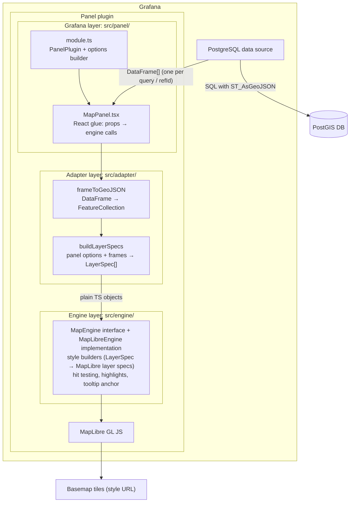

# Target Architecture: GeoFlow, a Grafana PostGIS Map Panel

Status: **Proposal, awaiting approval.** Nothing here is implemented yet.

### Project baseline

| Item | Value |
|---|---|
| Plugin name | GeoFlow |
| Plugin id | `jdejesusio-geoflow-panel` |
| Layer binding | Selectable mode; MVP ships "one layer per data frame" only (§3.4) |
| Target Grafana | 13.2+ (`grafanaDependency: ">=13.2.0"`) |
| Database | PostgreSQL 16+ with PostGIS 3.x |
| Default basemap | OpenStreetMap standard raster tiles |
| License | Apache-2.0; dependency license compatibility check pending (§5.4) |
| Dev environment | Docker Compose; deployment files under `docker/grafana/` and `docker/postgres/` |

This document responds to the five pre-implementation items in [project_overview.md](project_overview.md):

1. Application architecture
2. Major components and responsibilities
3. Data frame → GeoJSON conversion
4. Compatibility and performance risks
5. Development and testing strategy

---

## 1. Architectural overview

The plugin is a **frontend-only Grafana panel plugin**. It has no backend component and opens no database connection of its own. All data reaches it through Grafana's built-in PostgreSQL data source, as `DataFrame`s in `PanelProps.data`.



### Key decisions

| Decision | Rationale |
|---|---|
| Panel plugin only, no backend | Requirement 1 and 2. Grafana's PostgreSQL data source already handles auth, connection pooling, macros, template variables and caching. |
| SQL returns GeoJSON text via `ST_AsGeoJSON(...)` | GeoJSON is what MapLibre consumes natively. Parsing WKB in the browser would add a dependency and CPU cost for no MVP benefit. |
| Three layers: panel / adapter / engine | Requirement 7. The engine can be tested, reused or replaced (for example by OpenLayers or deck.gl) without touching Grafana code. |
| Engine boundary enforced by lint, not convention | An ESLint `no-restricted-imports` rule on `src/engine/**` forbids `@grafana/*`, `react` and `../panel`/`../adapter` imports. |
| Layer binding is a selectable mode, starting with "one layer per data frame" | Per-frame binding maps onto Grafana's existing query editor UX, where users already add queries A, B, C. "Layers by column value" is added in a later phase. Both modes live in the adapter and produce the same `LayerSpec[]`, so the engine never changes (§3.4). |
| Map instance is created once and updated in place | Re-creating a WebGL context on every refresh is slow and leaks contexts. Data updates go through `GeoJSONSource.setData()`. The one exception is scrolling: a panel destroys its map once it is off screen and creates it again when it comes back (§4.1, panel lifecycle). |

---

## 2. Components and responsibilities

### 2.1 Directory layout

Scaffolded with `npx @grafana/create-plugin@latest` (panel type). The repository then follows the standard layout, with three source subfolders and a `docker/` directory holding one independent directory per service:

```
docker-compose.yaml            # root compose file; wires the services below
                               # (kept at root so create-plugin's `npm run server` works)
docker/
  grafana/                     # Grafana deployment files; the image itself is the
                               # scaffold-managed .config/Dockerfile (live reload, CI modes)
    .env.example               # data source connection settings (GEOFLOW_PG_*)
    provisioning/
      datasources/datasources.yml # GeoFlow PostGIS data source → postgres service
      dashboards/              # dashboard provider + one JSON dashboard per feature
  postgres/                    # everything the database container needs
    Dockerfile                 # FROM postgis/postgis:16-3.6
    .env.example               # POSTGRES_USER / PASSWORD / DB, reader password
    verify.sql                 # fixture sanity checks
    init/                      # executed on first start via /docker-entrypoint-initdb.d
      01_extensions.sql        # CREATE EXTENSION postgis
      02_schema.sql
      03_seed_fixtures.sql     # every geometry type, non-4326, invalid/empty rows
      04_seed_large.sql        # generated rows for performance testing
      05_reader_role.sh        # read-only grafana_reader role
src/
  module.ts                    # PanelPlugin registration + options
  plugin.json
  panel/                       # Grafana-aware layer
    MapPanel.tsx
    FeatureTooltip.tsx         # tooltip content, with Grafana's tooltip components
    options.ts                 # PanelOptions types + builder
    editors/LayersEditor.tsx   # custom option editor for the layer list
  adapter/                     # Grafana DataFrame ⇄ neutral model
    frameToGeoJSON.ts
    detectGeometryField.ts
    buildLayerSpecs.ts
    __tests__/
  engine/                      # framework-neutral rendering
    types.ts                   # LayerSpec, LayerStyle, ViewState, MapEngine
    MapLibreEngine.ts
    styleBuilders.ts           # pure: LayerSpec → maplibre LayerSpecification[]
    __tests__/
  model/                       # shared plain types (GeoJSON helpers, errors)
tests/                         # Playwright e2e (@grafana/plugin-e2e)
LICENSE                        # Apache-2.0
NOTICE                         # third-party attributions (see §5.4)
```

The Grafana and Postgres directories don't depend on each other. Each one can be rebuilt, swapped (for example an external managed Postgres) or reused in another compose file. The only link between them is the data source provisioning file. It reads the host, user and password from environment variables, so nothing is hard-coded.

### 2.2 Panel layer (`src/panel`, Grafana-aware)

- **`module.ts`**: `new PanelPlugin<MapOptions>(MapPanel).setPanelOptions(...)`. It declares basemap, view, tooltip and layer options. `useFieldConfig()` is enabled so per-field units, decimals, value mappings and data links work in tooltips (Phase 4).
- **`MapPanel.tsx`**: A thin React component.
  - On mount: create a `div`, call `engine.mount(div, initialView, basemap)`.
  - On `data` / `options` change: call the adapter to build `LayerSpec[]`, then call `engine.setLayers(specs)`.
  - On `width` / `height` change: call `engine.resize()`.
  - On theme change (`useTheme2()`): call `engine.setBasemap()` if a light/dark style pair is configured.
  - On unmount: call `engine.destroy()`.
  - Shows conversion warnings (for example "12 rows had invalid geometry") through Grafana's panel notice mechanism. Shows "No data" or a configuration hint when no geometry field is found.
- **`LayersEditor.tsx`**: A custom option editor for the ordered list of spatial layers (add, remove, reorder, per-layer settings).

### 2.3 Adapter layer (`src/adapter`)

This is the only place that knows about both `DataFrame` and GeoJSON. Its functions are pure, deterministic and unit-testable.

- `detectGeometryField(frame)`: picks the geometry column (see §3).
- `frameToFeatureCollection(frame, mapping) → { fc, warnings }`.
- `buildLayerSpecs(frames, options, theme) → LayerSpec[]`: joins the layer configuration with frames by `refId` and resolves style defaults from the Grafana theme. Tooltip values are formatted with Grafana's field display processor when a feature is hovered or clicked (Phase 4), so the engine never needs Grafana formatting code.

### 2.4 Engine layer (`src/engine`, Grafana-independent)

A neutral contract:

```ts
interface MapEngine {
  mount(container: HTMLElement, view: ViewState, basemap: BasemapSpec): void;
  setBasemap(basemap: BasemapSpec): void;
  setLayers(layers: LayerSpec[]): void;      // diffed: add/update/remove
  fitToData(padding?: number): void;
  setView(view: ViewState): void;
  resize(): void;
  on(event: 'hover' | 'click' | 'viewChange', cb: (...) => void): () => void;
  destroy(): void;
}

interface LayerSpec {
  id: string;                  // stable across refreshes
  name: string;
  visible: boolean;
  data: FeatureCollection;
  style: LayerStyle;           // color, opacity, radius, lineWidth, fillOpacity…
  interactive: boolean;        // hover and click tooltips; per-layer tooltip fields in Phase 6
}
```

- **`MapLibreEngine`** implements the contract. Each `LayerSpec` maps to one GeoJSON source and up to four MapLibre style layers:
  - `fill` and a `line` outline for Polygon and MultiPolygon
  - `line` for LineString and MultiLineString
  - `circle` for Point and MultiPoint

  Each style layer is filtered by geometry type: `['match', ['geometry-type'], ['Polygon','MultiPolygon'], true, false]`. The list form keeps the filter correct across MapLibre versions, which differ on whether Multi* types are reported separately.
- **`setLayers`** diffs against current state by `id`:
  - Unchanged layer: no-op.
  - Changed data: `setData()`.
  - Changed style: `setPaintProperty()`.
  - Add or remove: add or remove the source and its layers.
  - A basemap `setStyle()` would drop user layers, so a `transformStyle` given at mount appends them to every new style (as built in Phase 3, below).
- **`styleBuilders.ts`** is pure: `LayerSpec → LayerSpecification[]`. Most styling logic can therefore be tested without WebGL.
- **Tooltips** (Phase 4, details below), following Grafana's own pattern: hovering a feature highlights it and shows a compact tooltip, and clicking pins a full one with a pager for overlapping features and the feature's data links.
  - The engine does the hit testing (rendered features of interactive layers, a few pixels around the pointer), emits `hover` and `click` events, sets the highlights with feature-state, and anchors one `maplibregl.Popup`.
  - The panel renders the tooltip's content with React and Grafana's tooltip components into a DOM element it hands to the engine. The engine stays Grafana-free, and React escapes every value, so attribute values never go through `innerHTML` (they're untrusted data).

#### MapLibre packaging (Phase 2)

MapLibre GL JS 6 shapes how the engine is built and shipped:
- **ESM only.** The package has no CommonJS build. Webpack bundles it without extra configuration. Jest can't load it, so unit tests mock `maplibre-gl` as a virtual module.
- **Lazy loading.** `createMapEngine()` loads the engine, MapLibre and its CSS with a dynamic `import()`, so they stay out of the plugin's initial `module.js`.
- **Worker.** MapLibre's worker is a separate file. MapLibre looks for it relative to its own `import.meta.url`, which webpack rewrites, so that lookup fails inside a plugin bundle. Instead, `src/engine/maplibre/workerUrl.ts` uses `new URL('maplibre-gl/dist/maplibre-gl-worker.mjs', import.meta.url)`: webpack emits the worker as an asset and resolves its served URL, and the engine passes that to `setWorkerUrl()`. The worker is same-origin, so it starts as a module worker without a `blob:` URL.
- **License notices.** The minified build only links to its license. A root `webpack.config.ts` (extending the scaffold config) adds a plugin that writes `THIRD_PARTY_NOTICES.txt` from the modules webpack bundled. MapLibre's dist file inlines its own dependencies, so their dependency trees are added too.

#### Drawing data (Phase 3)

How the engine draws `LayerSpec`s, as built:
- **`LayerSpec` fields so far:** `id`, `data` and `style`. `style` is a `LayerStyle` with `color`, `fillOpacity`, `lineWidth`, `pointRadius` and `outlineColor`, all resolved values. The adapter fills them from the Grafana theme and `DEFAULT_LAYER_STYLE`. `interactive` arrives with Phase 4 (tooltips), and `name` and `visible` with Phase 6.
- **Ids:** sources and style layers are prefixed `geoflow-layer:` (for example `geoflow-layer:A:fill`). The prefix keeps them apart from the basemap and from layers in a user's style URL. Layer ids come from refIds and are never parsed back out of these strings.
- **Geometry filters:** in MapLibre 6, `['geometry-type']` reports Multi* features as their simple type (MultiPolygon as Polygon). The filters list both forms, which is correct in every version.
- **Basemap changes:** `transformStyle`, passed to the `Map` constructor, appends the data sources and layers to every style MapLibre loads afterwards, inline or from a URL. MapLibre fires `style.load` both after a full style load and after a style it applied in place. The engine tracks readiness with `styledataloading` and `style.load`, and applies any `setLayers` call made in between on `style.load`.
- **Errors:** map errors from a data source carry the layer id (`EngineError.layerId`), so the panel shows them under the query rather than as basemap errors.
- **Test hook:** `MapEngine.renderedFeatureCounts()` waits for the map to be idle and counts distinct drawn features per layer. Only e2e tests use it, through a DOM event on the panel's map container. All test-only code in `src/` is marked `// Test hook:`.

#### Tooltips (Phase 4)

How hover and click tooltips work, as built ([phase_4.md](phase_4.md)):
- **Engine contract additions:**
  - `LayerSpec.interactive`: whether the layer's features can be hovered and clicked
  - `hover` and `click` events with a `PointerHit`: the pointer's `lngLat` and the `FeatureRef`s (`{ layerId, featureId }`) under it, topmost first
  - `openTooltip(lngLat, content, { interactive })`, `closeTooltip()`, and `tooltipSpace(lngLat)`: the largest tooltip that fits on the map when anchored there
  - `setHovered(ref)` and `setSelected(ref)`
- **Hit testing:** the rendered features of interactive layers within 4 px of the pointer, de-duplicated (MapLibre returns a feature once per tile and style layer). Hover runs at most once per animation frame. It reports while the pointer is over features, so a tooltip can follow it, and once when it leaves them. Clicks inside a pinned tooltip aren't map clicks.
- **Tooltip:** one MapLibre `Popup` the engine anchors, with content the panel owns. The panel renders `FeatureTooltip`, built from Grafana's `VizTooltip*` components, into that element through a React portal. A hover tooltip lets the pointer through (`pointer-events: none`); passing the same element again only moves the popup.
- **Tooltip size:** MapLibre opens the popup above or below the point, and centered on it or beside it, wherever it fits, 8 px from the map's edges. It doesn't shrink content that fits nowhere, so the panel sizes the tooltip to `tooltipSpace` when it opens: the room on the roomier side of the point, or centered across it. The header and data links keep their height, and the field list between them scrolls. A pinned tooltip keeps its size while the map pans, so panning can carry it past an edge. A hover tooltip can't be scrolled, since the pointer passes through it; pinning it can.
- **Highlights:** MapLibre feature-state (`hovered`, `selected`), read by `case` expressions in the style layers' paint.
- **Panel state:** `useFeatureTooltip` keeps the hover and pinned state. What's shown is derived from the current engine, basemap, data and Tooltip mode, so a basemap change or a recreated map closes the tooltip without effects that reset state.
- **Values:** formatted when a feature is hovered or clicked, from its data frame row, with the field config Grafana applied (`useFieldConfig()` in `module.ts`).

---

## 3. Converting Grafana data frames to GeoJSON

### 3.1 Expected query shape

Users write queries in **Table** format, not Time series format, which would pivot the columns:

```sql
SELECT
  id,
  name,
  status,
  ST_AsGeoJSON(ST_Transform(geom, 4326), 6) AS geometry
FROM assets
WHERE $__timeFilter(updated_at)   -- optional; any Grafana macro works
```

- Everything in this section works on PostgreSQL 16+ with PostGIS 3.x. `ST_AsGeoJSON(record)` (Feature output) needs PostGIS 3.0 or later.
- `ST_Transform(..., 4326)` is required unless the data is already in WGS84. GeoJSON (RFC 7946) and MapLibre assume lon/lat.
- The precision argument (`6` ≈ 0.1 m) roughly halves payload size compared with the default of 9 decimals.

Also accepted:

- A column containing a full **GeoJSON Feature**, e.g. `ST_AsGeoJSON(t.*)`. Its `properties` are merged with the other columns.
- A `json` / `jsonb` geometry column. On Grafana 13.2 this arrives as a field of type `other` whose values are already-parsed objects (verified in Phase 0); string values are handled too.

### 3.2 Geometry field resolution

Resolution runs in this order:

1. An explicit field name from the layer config. If no column has that name, this is reported rather than silently falling back to detection.
2. A field named `geometry`, `geom`, `geojson`, `the_geom`, `wkb_geometry` or `shape` (case-insensitive), of type string or other, whose content looks like GeoJSON.
3. The first string or other field whose content parses as GeoJSON geometry or Feature.

"Content" means the first ten non-null values: one malformed leading row doesn't hide a geometry column.

If nothing matches, the panel shows a hint instead of failing silently. When a column holds hex WKB/EWKB (a raw `geom` column), the hint says to wrap it in `ST_AsGeoJSON(...)`.

### 3.3 Row conversion algorithm

```
for each row i in 0..frame.length:
  raw = geomField.values[i]
  if raw is null/empty            → skip (count as "empty")
  obj = typeof raw === 'string' ? JSON.parse(raw) : raw      (try/catch → "invalid")
  if obj.type === 'Feature'       → geometry = obj.geometry, baseProps = obj.properties
  else                            → geometry = obj, baseProps = {}
  validate geometry.type ∈ {Point, MultiPoint, LineString, MultiLineString,
                            Polygon, MultiPolygon}           (GeometryCollection → "unsupported")
  crs member other than EPSG:4326 / CRS84                    → skip ("projected", names the CRS)
  empty coordinates (PostGIS POINT EMPTY → [])               → skip ("empty")
  coordinates nested wrongly or not finite numbers           → skip ("invalid")
  any position outside lon ±180 / lat ±90                    → skip ("outOfRange")
  properties = baseProps, then { other field name → field.values[i] } (columns win)
  id = ids from the id column if all are unique finite numbers, else i
  push { type:'Feature', id, geometry, properties }
return { FeatureCollection, warnings: counts per kind + first five samples }
```

Notes:

- The adapter iterates `field.values` arrays directly instead of using `DataFrameView`. This avoids creating a proxy object per row on large frames.
- **Feature ids and keys** (Phase 4): two separate identities.
  - **MapLibre's feature id** is used for hit testing and feature-state highlights. MapLibre keeps ids only as non-negative whole numbers: it reads a negative id back as an unsigned 64-bit number and cuts decimals, so 7.2 and 7.7 collide (checked in Phase 4, step 4.1). The `id` column's values are used only when every one is a unique whole number from 0 to `Number.MAX_SAFE_INTEGER`. Otherwise every feature gets its row index, so a fallback id can never collide with a real one.
  - **The feature key** follows a feature through a refresh. It's the `id` column's value, a number or a string, when every feature has one and they're all unique; otherwise there are no keys.
  - The column's values stay in `properties` either way. Each conversion also records every feature's row (`featureRows`), and `featureRow`, `featureKey` and `featureByKey` look features up with cached maps.
- **Nested property values** (objects or arrays) are JSON-stringified, because MapLibre flattens them anyway.
- **Display values** for tooltips are computed with `field.display(value)` and kept apart from the feature properties, which stay raw for data-driven styling later. Phase 4 formats them when a feature is hovered or clicked, rather than up front for every row ([phase_4.md](phase_4.md)).
- **Not supported in MVP**:
  - `GeometryCollection`: counted as "unsupported" and reported.
  - Z/M coordinates: passed through; MapLibre ignores them.
  - Raw WKB / EWKB hex: left for a later phase if requested.

### 3.4 Layer binding modes

How data frames become map layers is a panel option, `layerBinding.mode`:

| Mode | Behavior | Delivered in |
|---|---|---|
| `perFrame` (default) | Each data frame (one per query refId) becomes one layer. Layer id = `refId`. Layer config can override the geometry field, id field, style and tooltip fields. | MVP (Phases 3–6) |
| `byColumn` | The user picks a source frame and a **split column**. Each distinct value of that column becomes its own layer with id `${refId}:${value}`. Layer names come from the values. | Phase 10 |

Design rules that keep later modes cheap to add:

- The option type is a discriminated union from day one:

  ```ts
  type LayerBinding =
    | { mode: 'perFrame' }
    | { mode: 'byColumn'; refId: string; splitField: string; maxLayers: number };
  ```

  Saved MVP dashboards stay valid when `byColumn` ships, because no migration is needed. Until then the editor offers only `perFrame`.
- Binding is resolved in `buildLayerSpecs` (adapter) through a small strategy per mode: `bindPerFrame` and later `bindByColumn`. Each strategy returns the same `LayerSpec[]`. The engine is unaffected, which is the payoff of requirement 7.
- `byColumn` specifics, scoped for Phase 10:
  - **Stable ids across refresh.** Per-layer settings such as visibility and style overrides survive a refresh, and new values get defaults.
  - **Layer cap.** `maxLayers`, default 50, guards against splitting on a high-cardinality column. Values beyond the cap are grouped into an "Other" layer and reported as a panel warning.
  - **Per-value colors.** Values get colors from the Grafana theme's classic palette, overridable through standard Grafana value mappings.
  - **Null or empty split values** go into a "(none)" layer.

---

## 4. Compatibility and performance risks

### 4.1 Compatibility

| Risk | Mitigation |
|---|---|
| **Grafana version range.** Plugin APIs and the data source id changed over time (`postgres` → `grafana-postgresql-datasource`). | Target Grafana 13.2 and later: `grafanaDependency: ">=13.2.0"` in `plugin.json`, with `@grafana/*` packages pinned to 13.2.x. Do not depend on the data source id; read only `DataFrame`s. Run e2e tests against the minimum and latest versions (resolved by CI from `grafanaDependency`). |
| **PostgreSQL / PostGIS versions.** | Support PostgreSQL 16+ with PostGIS 3.x. The dev image is pinned to `postgis/postgis:16-3.6`. An optional CI job runs the fixtures against the newest Postgres major to catch SQL differences in the documented queries. |
| **Content Security Policy.** Grafana's optional CSP limits `connect-src` to `'self' grafana.com *.cartocdn.com`, and MapLibre fetches raster tiles with `fetch()`. | Checked in Phase 2 with Grafana's default template. The worker, chunks and CSS load without changes, because the worker is a same-origin file set with `setWorkerUrl()` (no `blob:`). Tile servers are blocked until they're added to `connect-src`. The README documents the directive. |
| **WebGL availability.** MapLibre 6 requires WebGL2. Headless renderers, old GPUs and VDI environments may lack it. | Detect support on mount and show a clear message instead of a blank panel. Document the image renderer limitation. |
| **Basemap tiles and air-gapped installs.** Public tile servers have usage policies and need internet access. | The default is OpenStreetMap's standard raster tiles (`https://tile.openstreetmap.org/{z}/{x}/{y}.png`). They're wrapped in a minimal inline MapLibre style, because OSM serves tiles, not a style JSON. Caveats: OSM's [tile usage policy](https://operations.osmfoundation.org/policies/tiles/) forbids heavy or bulk use and requires the attribution "© OpenStreetMap contributors". The panel always shows that attribution through MapLibre's attribution control. The basemap is configurable (raster tile URL template or a vector style URL) so production users can point at their own tile server. A "no basemap" (blank background) option covers air-gapped installs. |
| **MapLibre CSS.** Without it, controls and tooltips render broken. | The lazily loaded engine module imports `maplibre-gl/dist/maplibre-gl.css`. It is injected after the panel's Emotion styles and wins ties: `.maplibregl-map { position: relative }` collapsed an absolutely positioned map container to zero height, so the container is sized with `width`/`height: 100%`. Overrides that match controls to the Grafana theme are scoped under the panel's class. |
| **Panel lifecycle.** Grafana mounts panels lazily as they scroll into view but doesn't unmount them when they scroll away. Chromium allows 16 live WebGL contexts per page and drops the oldest beyond that. | Found in Phase 2 with a 20-panel dashboard. A panel creates its map only while it is on screen or within 200 px of it (`IntersectionObserver`), and destroys it straight away when it leaves. `map.remove()` releases the context, and a recreated map resumes the user's last view. If a context is still lost, the panel shows "Map paused" with a Reload button. Option changes never recreate the map. The `03-many-panels` e2e test covers this. |
| **Theme switching** (light/dark). | OSM raster tiles have no dark variant. In dark theme the engine adjusts `raster-brightness-max` / `raster-saturation` paint properties to dim the basemap, which needs no second tile source. Users can also configure an explicit dark basemap. Default layer colors come from `theme.visualization`. |
| **Coordinate systems.** Data not in EPSG:4326 renders in the wrong place or not at all. | Document `ST_Transform` usage. The adapter warns when coordinates fall outside ±180/±90. |
| **Antimeridian-crossing geometries.** | These are known MapLibre/GeoJSON edge cases. Document the issue rather than solve it in the MVP. |

### 4.2 Performance

| Concern | Approach |
|---|---|
| **Payload size.** GeoJSON text is verbose. | Recommend `ST_AsGeoJSON(geom, 6)`. For detailed polygons, recommend `ST_SimplifyPreserveTopology`. Mention the data source row limit (`row_limit` in Grafana config). |
| **Main-thread parsing.** `JSON.parse` per row plus FeatureCollection construction blocks the UI on large results. | Benchmark at 1k, 10k, 100k features in Phase 8. If 100k blocks too long, move conversion to a web worker. MapLibre's own `geojson-vt` tiling already runs in its worker. A first measurement in Phase 3: 100k points draw about 2.5 s after the query returns, with main-thread tasks of up to about 0.5 s. |
| **Hover on large data.** Hit testing runs on every pointer move, and a highlight changes feature-state on a large source. | Measured on 100k points in Phase 4 with the machine's GPU: hover is as fast as plain panning, with no main-thread task over 50 ms. Headless Chromium's default software rendering (SwiftShader) is far slower for anything that redraws a large layer, including panning, so performance has to be judged with the GPU (`--enable-gpu --ignore-gpu-blocklist --use-angle=gl`), not in the default e2e browser. |
| **Redundant work on refresh.** | Conversion is cached per frame object (Phase 3), so a frame Grafana didn't replace keeps its data and the engine skips `setData`. Skipping frames that are new objects with the same content (structural hash) and keeping the viewport across refreshes unless "fit to data on refresh" is on come in Phase 7. |
| **Re-renders from React.** | Hold the engine in a `useRef`. Effects depend on narrow inputs (`data.series`, `options.layers`, `width`, `height`), never on the whole props object. |
| **Bundle size.** MapLibre 6 is about 1.1 MiB minified, plus a 0.5 MiB worker. | The engine loads MapLibre lazily, so the plugin's initial `module.js` stays about 19 KiB. The Bundle Stats workflow reports size changes on every PR. |
| **Beyond about 100k features.** | Out of scope for the MVP. The future path is vector tiles from PostGIS (`ST_AsMVT` via Martin or pg_tileserv). This would be a deliberate exception to "Grafana data source only" and needs separate approval. |

---

## 5. Development and testing strategy

### 5.1 Local environment

- Scaffold with `@grafana/create-plugin`. It provides webpack, Jest, Playwright, ESLint, the Docker Compose Grafana dev image and GitHub Actions CI.
- Keep the scaffold-managed Grafana image (`.config/`, Grafana 13.2.x) and put the Grafana deployment files (provisioning, env) in `docker/grafana/`. The built plugin (`dist/`) is mounted as `jdejesusio-geoflow-panel`.
- Add a `postgres` service built from `docker/postgres/` (`postgis/postgis:16-3.6`). Seed it from `docker/postgres/init/` with fixture tables covering every geometry type, a non-4326 table, invalid and empty rows, and a large table for performance tests. Use a named volume for data. `docker compose down -v` resets it to the seed state.
- Provision the PostgreSQL data source and a set of dashboards in `docker/grafana/provisioning/`. Each dashboard exercises one feature: points only, mixed types, multi-layer, refresh. Every dashboard doubles as an e2e fixture.
- The root `docker-compose.yaml` adds a healthcheck on `postgres` (`pg_isready`). Grafana uses `depends_on: condition: service_healthy`, so provisioned dashboards never start against an unready database.

### 5.2 Test pyramid

| Level | Tooling | Covers |
|---|---|---|
| Unit | Jest | Adapter: `frameToFeatureCollection` across all geometry types, Feature input, string vs object values, null/invalid/unsupported rows, id handling, field detection. Engine: `styleBuilders` output and the `setLayers` diff logic with `maplibre-gl` mocked. jsdom has no WebGL, so the real map is not exercised here. |
| Component | Jest + React Testing Library | `MapPanel` calls the engine correctly on mount, data change, resize and unmount. Uses a fake `MapEngine`, which is another payoff of the interface. Covers the "no geometry field" hint. |
| End-to-end | Playwright + `@grafana/plugin-e2e` against the Docker stack | The panel loads in provisioned dashboards. The canvas renders. Hovering and clicking known features shows tooltips with the expected attributes and data links. Option changes take effect. Dashboard refresh updates features. Runs against the minimum supported Grafana (13.2) and the latest release. |
| Manual / perf | Provisioned "large" dashboard + browser profiler | Conversion and render timings at 1k, 10k and 100k features. |

CI runs lint (including the engine import boundary), typecheck, unit tests, build, `@grafana/plugin-validator`, the license check (§5.4) and e2e on every PR.

### 5.3 Incremental delivery plan

Each phase ends with something demonstrable and its own tests. I will stop for review after each phase.

| Phase | Deliverable | Verified by |
|---|---|---|
| 0 | Scaffold, `docker/grafana` + `docker/postgres` stack with seed data, provisioned data source, placeholder panel, Apache-2.0 `LICENSE` | Panel appears in Grafana 13; CI green |
| 1 | Adapter: `frameToFeatureCollection` + field detection (no UI) | Unit tests |
| 2 | Engine skeleton: `MapEngine`, `MapLibreEngine` with basemap only, mount/resize/destroy; panel shows interactive basemap | Component test + e2e "map canvas visible" |
| 3 | Single-layer rendering of all six geometry types with default style | Style-builder unit tests + e2e on mixed-geometry dashboard |
| 4 | Tooltips: hover highlight and tooltip, click to pin, feature attributes formatted via field config, data links | e2e hover and click → tooltip content and links |
| 5 | Basic styling options (color, opacity, point radius, line width, fill opacity) | Unit tests + e2e option change |
| 6 | Multiple layers in `perFrame` mode: layer list editor, `LayerBinding` option (only `perFrame` exposed), ordering, visibility | Unit tests on `buildLayerSpecs` + e2e multi-layer dashboard |
| 7 | Refresh behavior: in-place `setData`, viewport preservation, fit-to-data option, theme switching | Component tests + e2e refresh |
| 8 | Hardening: warnings/notices, WebGL detection, CSP docs, performance benchmark and any resulting optimization | Perf dashboard results recorded in docs |
| 9 | Dependency license compatibility review (§5.4) | `docs/licenses.md` report; CI license gate passing |

Phases 0–9 make up the **MVP**. Post-MVP phases each add one capability:

| Phase | Deliverable | Verified by |
|---|---|---|
| 10 | `byColumn` layer binding (§3.4): split column picker, layer cap + "Other", per-value colors, stable ids across refresh | Unit tests on `bindByColumn` (cardinality, nulls, id stability) + e2e dashboard split by a category column |

### 5.4 License compliance

The project is licensed under **Apache-2.0**. Every dependency that ends up in the shipped bundle (`dist/`) must have a license compatible with distributing it under Apache-2.0. Dev-only tooling matters less, because it isn't redistributed.

- **Known so far (to be confirmed in the review):**
  - `maplibre-gl` is BSD-3-Clause, which is compatible.
  - `@grafana/*` runtime packages are Apache-2.0. They are provided by Grafana at runtime as externals, not bundled.
  - React is MIT.
- **Basemap data is not code.** OpenStreetMap data is under ODbL, which is not a dependency license. It obliges visible attribution ("© OpenStreetMap contributors"), which the panel always displays. This goes in `NOTICE` and the README.
- **Process:**
  1. From Phase 0, a license scanner (for example `license-checker-rseidelsohn` or `license-report`) runs in CI over production dependencies.
  2. An allow-list (Apache-2.0, MIT, BSD-2/3-Clause, ISC, 0BSD, CC0-1.0) passes automatically.
  3. Anything else, especially GPL/AGPL/LGPL, SSPL or unknown, fails the build until it's reviewed.
  4. The Phase 9 review produces `docs/licenses.md` and a populated `NOTICE` file before the first public release.

---

## 6. Decisions

All open items are resolved.

| Topic | Decision |
|---|---|
| Plugin name | GeoFlow |
| Plugin id | `jdejesusio-geoflow-panel` (org slug `jdejesusio`) |
| Layer binding | Selectable mode: `perFrame` in the MVP, `byColumn` in Phase 10 |
| Grafana version | 13.2+ |
| PostgreSQL version | 16+ (PostGIS 3.x) |
| Default basemap | OpenStreetMap standard raster tiles, with attribution |
| License | Apache-2.0, pending the dependency license review |
| Dev environment | Docker; `docker/grafana/` and `docker/postgres/` kept independent |

---

## 7. Features considered for later

Features that have come up but aren't in a phase yet. Each one would get its own plan and approval before any work starts. The context records why it was left out and what it would take, so the reasoning isn't lost.

| Feature | Context | What it would take |
|---|---|---|
| **Actions in tooltips** | Grafana's actions are buttons, configured per field like data links, that send an HTTP request (for example to acknowledge an alarm or open a ticket). Requested alongside data links, which Phase 4 delivers. Grafana 13's `VizTooltipFooter` accepts ready-made actions, but the code that builds them from a field's action settings, with variable interpolation, confirmation and permission checks, is internal to Grafana and not exported to plugins. Fields carry only the raw `config.actions` settings. | First, check whether the Grafana version of the day exports a way to build actions for plugins. If it does, it's a small addition to the pinned tooltip's footer. If not, the plugin would have to rebuild Grafana's request handling, variable interpolation and confirmation itself, and keep it in step with Grafana. That needs a separate decision. |
| **One-click data links** | Grafana's link editor has an **Open with one click** setting: in Grafana's own panels, a click then opens the link directly instead of showing the tooltip. Phase 4 always pins the tooltip on click, with the link in its footer. | On click, when the topmost feature has a one-click link, open it instead of pinning. Needs a decision on overlapping features, where several features may each have one. |
| **Keyboard selection of features** | Mouse and touch only in Phase 4. MapLibre's keyboard support covers panning and zooming, not features. | A way to move a focus through the features in view (for example a hidden, focusable list in drawing order), with the tooltip following it, and screen-reader text. |
| **Data drawn below a style URL's labels** | Phase 3 draws data on top of the whole basemap, labels included (Phase 3, decision 3). | An option that inserts the data layers before the first `symbol` layer of a style URL. It depends on how each style is built. |
| **Raw WKB/EWKB geometry** | §3.3. Hex WKB from a raw `geom` column is detected, and the panel asks for `ST_AsGeoJSON(geom)` instead. | A WKB parser in the adapter, which is a new bundled dependency (license review, §5.4) and main-thread cost. |
| **GeometryCollection** | §3.3. Rows are skipped and reported as `unsupported`. | Splitting a collection into its parts in the adapter, with a decision on how the parts share one feature's tooltip and id. |
| **Vector tiles for very large data** | §4.2. Beyond about 100k features, GeoJSON through the data source gets slow. | Vector tiles from PostGIS (`ST_AsMVT` through Martin or pg_tileserv). This is a deliberate exception to "Grafana data source only" and needs separate approval. |
| **Antimeridian-crossing geometries** | §4.1. Documented rather than solved. | Splitting or unwrapping geometries that cross ±180° in the adapter. |
